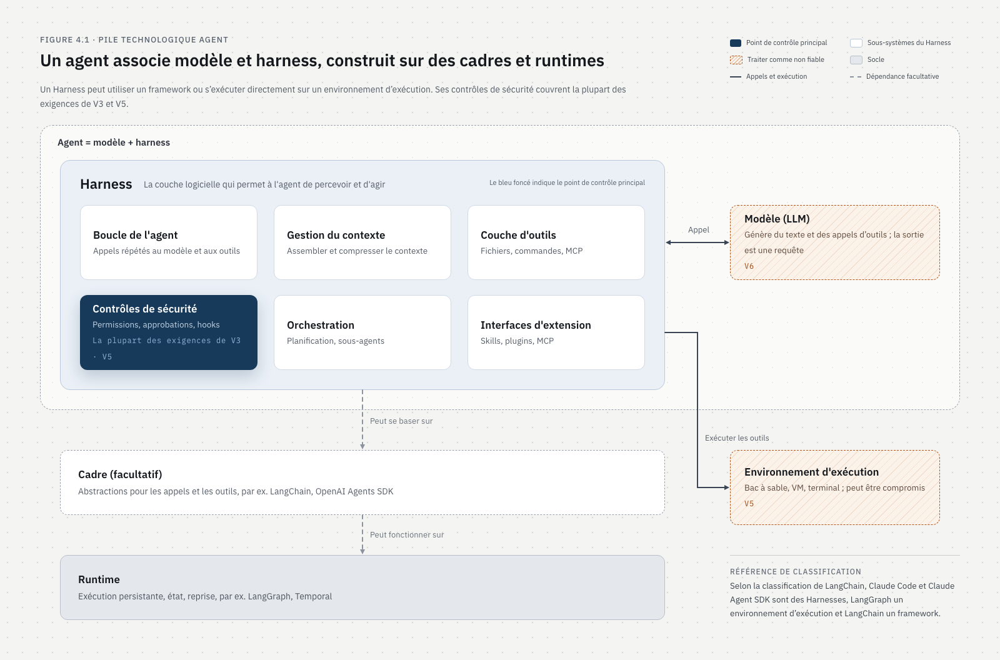
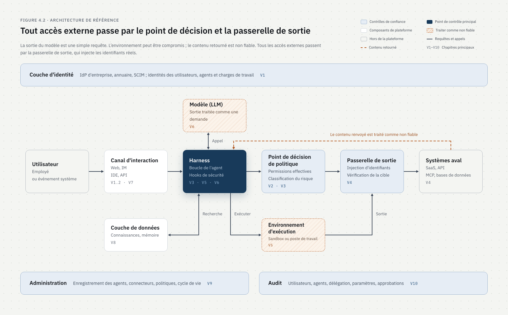

# Référentiel de sécurité de l'identité et de l'autorisation des agents d'entreprise

Auteur : Max Luo · 2026-10-07

Projet initié et maintenu par [Teloa AI Security](https://github.com/teloa-ai)

Ce référentiel est publié sous licence [CC BY 4.0](../../LICENSE-DOCS).

## Préambule

Max Luo a élaboré ce référentiel pendant le développement et la conception de la sécurité de [Teloa](https://github.com/teloa-ai/teloa). Initié et maintenu par Teloa AI Security, il est ouvert à l'utilisation et à la revue pour différentes plateformes d'agents d'entreprise. Il décrit des objectifs de sécurité sans déclarer que Teloa ou un autre produit satisfait à toutes les exigences. L'état de l'implémentation doit être vérifié selon une version, un périmètre de déploiement et des preuves précis. L'auto-évaluation n'est pas une certification indépendante ; les références et correspondances ne valent pas approbation des éditeurs. Voir les [choix de conception (en anglais)](../../04-design/en/design-rationale.md).

Le présent référentiel définit les exigences de sécurité en matière d'identité et d'autorisation que doivent satisfaire les agents évoluant en environnement d'entreprise. Les exigences sont réparties en dix chapitres, d'abord selon l'ordre dans lequel se déroule un comportement de l'agent, puis selon les objets qui persistent d'une session à l'autre. Chaque exigence peut être vérifiée isolément. Elles sont réparties en trois niveaux, L1 à L3.

Le principe directeur qui traverse l'ensemble des exigences est la moindre autonomie (*least agency*) : ne donner à l'Agent que le périmètre d'action et le degré d'autonomie strictement nécessaires à la réalisation de sa mission métier. Le moindre privilège régit ce que l'Agent peut atteindre ; la moindre autonomie régit en outre ce qu'il peut décider de lui-même et la durée pendant laquelle il peut fonctionner sans supervision.

Le présent référentiel peut être utilisé de trois manières :

- construction de la plateforme : choisir le niveau cible, mettre en œuvre chaque exigence, celles-ci servant à la fois d'éléments de conception et de cas de test ;
- évaluation des fournisseurs : utiliser les exigences comme questionnaire, en demandant au fournisseur de décrire, pour chacune, la manière dont elle est mise en œuvre, et d'en fournir les preuves ;
- revue de sécurité : sélectionner les exigences applicables selon leurs conditions d'application, les vérifier une à une et consigner les conclusions dans la grille d'évaluation qui accompagne le référentiel.

La version actuelle est la v1.0. Elle reprend la structure de l'OWASP ASVS 5.0, et les exigences sont numérotées au format « V chapitre.section.article », par exemple V4.2.1. Toute citation doit mentionner le numéro de version.

## 1、Périmètre

Le présent référentiel s'applique aux plateformes d'agents et aux harness déployés ou acquis au sein de l'entreprise. Il ne traite que de l'identité au nom de laquelle l'Agent agit, de l'autorisation dont il dispose, de la voie par laquelle il accède aux ressources et de ce qu'il produit. L'isolation de l'exécution, le contrôle des sorties réseau et le contrôle des sorties de données sont des moyens de mise en œuvre de l'autorisation ; ils sont donc intégrés au présent référentiel.

Sont concernés :

- les plateformes d'agents et les applications d'agents développées en interne ;
- les plateformes d'agents SaaS acquises, ainsi que les agents intégrés dans un produit SaaS ;
- les agents exécutés sur les postes de travail des employés, tels que les agents de programmation, les assistants de bureau et les extensions de navigateur ;
- les deux modes de livraison, déploiement privé et SaaS.

Ne sont pas couverts :

- la gouvernance des données d'entraînement et de réglage fin des modèles, la robustesse des modèles et les exemples adverses, qui relèvent de l'OWASP AISVS et de la CSA AICM ;
- la sécurité des contenus et l'exactitude des sorties, notamment les hallucinations, les biais et les contenus nuisibles ;
- la conception du contrôle d'accès des systèmes métier aval eux-mêmes ; le présent référentiel exige seulement que ces systèmes puissent recevoir et vérifier l'identité de l'utilisateur transmise lorsqu'ils sont sollicités au nom de celui-ci ;
- la sécurité générale de l'infrastructure, telle que le durcissement des hôtes, la protection des périmètres réseau et la gestion des vulnérabilités, qui est appliquée selon les référentiels de base existants de l'entreprise.

Les exigences sont rédigées avec la plateforme pour sujet. Dans un contexte d'achat, c'est l'entreprise utilisatrice qui vérifie le fournisseur au regard des exigences. Dans le présent texte, « entreprise » désigne l'utilisateur, « plateforme » désigne le système qui fournit les capacités d'agent, et « fournisseur » désigne l'éditeur ou l'exploitant de la plateforme.

## 2、Références normatives et documents de référence

Les protocoles nommément cités dans une exigence, sans les mentions « tel que » ou « ou équivalent », constituent des références normatives ; leur mise en œuvre doit respecter leurs prescriptions. Les autres documents ne servent qu'à la mise en correspondance et au contexte.

| Document | Éditeur | Statut | Nature | Usage dans le présent référentiel |
| --- | --- | --- | --- | --- |
| [RFC 6749 OAuth 2.0 Authorization Framework](https://www.rfc-editor.org/rfc/rfc6749) | IETF | RFC officielle | Normative | Autorisation de l'utilisateur et jetons d'accès (V4.3) |
| [OpenID Connect Core 1.0](https://openid.net/specs/openid-connect-core-1_0.html) | OpenID Foundation | Spécification finale | Normative | Connexion via l'IdP de l'entreprise (V1.1.1) |
| SAML 2.0 | OASIS | Norme officielle | Normative | Connexion via l'IdP de l'entreprise (V1.1.1) |
| [RFC 8693 OAuth 2.0 Token Exchange](https://www.rfc-editor.org/rfc/rfc8693) | IETF | RFC officielle | Normative | Accès au nom de l'utilisateur, chaîne de délégation et déclaration act |
| [RFC 9449 OAuth 2.0 Demonstrating Proof of Possession (DPoP)](https://www.rfc-editor.org/rfc/rfc9449) | IETF | RFC officielle | Normative | Liaison des jetons à l'expéditeur (V4.6.2) |
| [RFC 8705 OAuth 2.0 Mutual-TLS Client Authentication and Certificate-Bound Access Tokens](https://www.rfc-editor.org/rfc/rfc8705) | IETF | RFC officielle | Normative | Liaison des jetons à l'expéditeur (V4.6.2) |
| [RFC 7489 DMARC](https://www.rfc-editor.org/rfc/rfc7489) | IETF | RFC informative | Normative | Vérification de l'expéditeur pour le canal courriel (V1.2.6) |
| [Model Context Protocol, spécification 2026-07-28](https://modelcontextprotocol.io/specification/versioning) | Projet MCP | Version courante | Normative | Appels et autorisation MCP (V4.5) |
| [RFC 9470 OAuth 2.0 Step Up Authentication Challenge Protocol](https://www.rfc-editor.org/rfc/rfc9470) | IETF | RFC officielle | Informative | Heure et force de l'authentification pour la seconde authentification (V1.1.3, V3.5) |
| [RFC 8707 Resource Indicators for OAuth 2.0](https://www.rfc-editor.org/rfc/rfc8707) | IETF | RFC officielle | Informative | Limitation de l'audience des jetons (V4.5.5, V4.6.3) |
| [RFC 9700 OAuth 2.0 Security Best Current Practice](https://www.rfc-editor.org/rfc/rfc9700) | IETF | BCP | Informative | Exigences de sécurité pour la mise en œuvre d'OAuth |
| RFC 7643, RFC 7644 SCIM | IETF | RFC officielles | Informative | Synchronisation et désactivation des utilisateurs et des groupes (V1.1.2) |
| [OpenID Shared Signals Framework 1.0](https://openid.net/wg/sharedsignals/) | OpenID Foundation | Spécification finale (septembre 2025) | Informative | Transmission des événements de sécurité |
| [OpenID Continuous Access Evaluation Profile (CAEP) 1.0](https://openid.net/specs/openid-caep-1_0-final.html) | OpenID Foundation | Spécification finale (septembre 2025) | Informative | Révocation de session et signaux de risque (V3.5.2, V10.4.4) |
| [RFC 9396 OAuth 2.0 Rich Authorization Requests](https://www.rfc-editor.org/rfc/rfc9396) | IETF | RFC officielle | Informative | Description fine des autorisations (V2.2.6) |
| [Identity Assertion JWT Authorization Grant (ID-JAG), projet -04](https://www.ietf.org/archive/id/draft-ietf-oauth-identity-assertion-authz-grant-04.html) | Groupe de travail OAuth de l'IETF | Projet de groupe de travail | Informative | Obtention de jetons aval auprès de l'IdP de l'entreprise, soit Cross-App Access (XAA) (V4.3.3, V4.5.4) |
| [RFC 7523 JWT Profile for OAuth 2.0 Client Authentication and Authorization Grants](https://www.rfc-editor.org/rfc/rfc7523) | IETF | RFC officielle | Informative | Octroi d'autorisation utilisé par l'ID-JAG |
| [Identity Continuation Assertion, projet -02](https://datatracker.ietf.org/doc/draft-mcguinness-oauth-id-continuation-assertion/) | Projet individuel de l'IETF | Projet individuel (septembre 2026) | Informative | Prolongation de la chaîne de délégation après la déconnexion de l'utilisateur |
| [Transaction Tokens, projet -11](https://datatracker.ietf.org/doc/draft-ietf-oauth-transaction-tokens/) | Groupe de travail OAuth de l'IETF | Projet de groupe de travail | Informative | Transmission du contexte d'autorisation sur la chaîne d'appels d'un même domaine de confiance (V2.4.7) |
| [OpenID AuthZEN Authorization API 1.0](https://openid.net/specs/authorization-api-1_0.html) | OpenID Foundation | Spécification finale (janvier 2026) | Informative | Interface standard du point de décision de politique (V3.2.5) |
| [SPIFFE](https://spiffe.io/) | CNCF | Spécification d'un projet diplômé | Informative | Identité de charge de travail et attestation des instances d'exécution (V1.4.5) |
| [WIMSE architecture, projet -08](https://datatracker.ietf.org/doc/draft-ietf-wimse-arch/) | Groupe de travail WIMSE de l'IETF | Projet de groupe de travail | Informative | Identité de charge de travail entre systèmes (V1.4) |
| [Extension MCP Enterprise-Managed Authorization](https://modelcontextprotocol.io/extensions/auth/enterprise-managed-authorization) | Projet MCP | Extension officielle | Informative | Accès aux serveurs MCP autorisé par l'IdP de l'entreprise (V4.5.4) |
| [NIST SP 800-207 Zero Trust Architecture](https://csrc.nist.gov/pubs/sp/800/207/final) | NIST | Publication officielle | Informative | Vérification continue et moindre privilège |
| [NIST SP 800-63-4 Digital Identity Guidelines](https://csrc.nist.gov/pubs/sp/800/63/4/final) | NIST | Publication officielle (juillet 2025) | Informative | Force de l'authentification et réauthentification |
| [NIST IR 8587, protection des jetons et assertions contre la falsification, le vol et l'usage abusif](https://csrc.nist.gov/pubs/ir/8587/final) | NIST | Publication officielle (septembre 2026) | Informative | Gestion des jetons |
| [NIST NCCoE, document de concept sur l'identité et l'autorisation des logiciels et agents d'IA](https://www.nccoe.nist.gov/sites/default/files/2026-02/accelerating-the-adoption-of-software-and-ai-agent-identity-and-authorization-concept-paper.pdf) | NIST | Projet soumis à consultation (février 2026) | Informative | Cadre des questions : identification, authentification, autorisation, délégation, audit, injection de prompt |
| [Back to the Future: Why Agentic AI Needs a Strong Identity Foundation](https://www.nist.gov/blogs/cybersecurity-insights/back-future-why-agentic-ai-needs-strong-identity-foundation) | NIST | Billet de blog du 27 août 2026 | Informative | Principes de base de l'identité et retours publics sur le document de concept |
| [OWASP Top 10 for Agentic Applications for 2026](https://genai.owasp.org/resource/owasp-top-10-for-agentic-applications-for-2026/) | OWASP | Publié en décembre 2025 | Informative | Correspondance des risques, voir annexe A ; origine de la moindre autonomie |
| [OWASP Top 10 for LLM Applications 2025](https://genai.owasp.org/llm-top-10/) | OWASP | Publié en novembre 2024 | Informative | Correspondance des risques, voir annexe A |
| [OWASP AISVS 1.0](https://owasp.org/www-project-artificial-intelligence-security-verification-standard-aisvs-docs/) | OWASP | Publié en juin 2026 | Informative | Correspondance des contrôles, voir annexe B |
| [OWASP ASVS 5.0](https://owasp.org/www-project-application-security-verification-standard/) | OWASP | Publication officielle | Informative | Structure du présent référentiel |
| [CSA AI Controls Matrix v1.1](https://cloudsecurityalliance.org/blog/2026/07/14/ai-controls-matrix-v1-1-strengthening-the-foundation-for-trustworthy-ai) | CSA | Publié en juillet 2026 | Informative | Correspondance des contrôles, voir annexe C |
| [Agent Frameworks, Runtimes, and Harnesses](https://www.langchain.com/blog/agent-frameworks-runtimes-and-harnesses-oh-my) | LangChain | Billet de blog d'octobre 2025 | Informative | Classification des cadres, runtimes et harness (4.1) |
| [The lethal trifecta for AI agents](https://simonwillison.net/2025/Jun/16/the-lethal-trifecta/) | Simon Willison | Article de juin 2025 | Informative | Risque combiné de données non publiques, de contenus non fiables et de transfert externe (V6.2, V7.5) |
| [The Dual LLM pattern](https://simonwillison.net/2023/Apr/25/dual-llm-pattern/) | Simon Willison | Article d'avril 2023 | Informative | Traitement des contenus non fiables par un modèle isolé (V6.2.4) |
| [CaMeL: Defeating Prompt Injections by Design](https://arxiv.org/abs/2503.18813) | Google DeepMind et autres | Article de recherche de 2025 | Informative | Séparation du flux de contrôle et du flux de données (V6.2.4) |

Les documents à l'état de projet peuvent être modifiés ou retirés. Lors de leur adoption, c'est la version la plus récente au moment de la mise en œuvre qui fait foi.

## 3、Termes et définitions

Les termes suivants ont un sens particulier dans le présent référentiel ; lorsqu'ils figurent dans les exigences, ils doivent être compris selon les définitions ci-dessous.

| Numéro | Terme | Définition |
| --- | --- | --- |
| 3.1 | Agent (agent) | Système d'IA capable de comprendre un objectif, d'appeler des outils et d'accomplir de manière autonome une tâche en plusieurs étapes. Le corps du présent référentiel l'abrège en « Agent » |
| 3.2 | Harness | Couche logicielle qui entoure le modèle et permet à l'Agent de percevoir son environnement et d'agir. Elle se compose de plusieurs sous-systèmes : boucle de l'Agent, gestion du contexte (y compris la compression), couche d'outils, contrôles de sécurité (permissions, approbations, hooks), orchestration (planification, sous-agents) et interfaces d'extension (Skill, plug-ins, MCP). Claude Code, Claude Agent SDK et DeepAgents relèvent de cette catégorie. Le présent référentiel conserve le terme anglais d'origine |
| 3.3 | Cadre (framework) | Bibliothèque fournissant des abstractions de développement pour l'appel des modèles et la définition des outils, telle que LangChain, OpenAI Agents SDK ou Vercel AI SDK |
| 3.4 | Runtime | Infrastructure fournissant à l'Agent une exécution persistante, la sauvegarde de son état et la reprise après incident, telle que LangGraph ou Temporal. Un harness peut être construit au-dessus d'un runtime |
| 3.5 | Environnement d'exécution | Environnement dans lequel le harness exécute le code, les commandes, les opérations sur fichiers et sur navigateur, tel qu'un bac à sable conteneurisé, une machine virtuelle ou le poste de travail d'un employé |
| 3.6 | Plateforme | Système global qui fournit la création, l'exécution et la gestion des Agents. Il comprend le harness, le runtime, l'environnement d'exécution, le point de décision de politique, la passerelle de sortie et la console d'administration |
| 3.7 | Fournisseur | Éditeur ou exploitant de la plateforme |
| 3.8 | Utilisateur | Personne physique disposant d'une identité dans l'IdP de l'entreprise et utilisant un Agent |
| 3.9 | Agent autonome (autonomous agent) | Agent qui exécute des opérations sous sa propre identité et n'agit pas au nom d'un utilisateur donné. Il accède en général aux systèmes aval avec une identité d'application, par opposition à l'accès au nom de l'utilisateur. Ici, « autonome » désigne le fait de s'exécuter sous sa propre identité (correspondant à l'autonomous agent de Microsoft Entra Agent ID) et n'a aucun rapport avec le degré d'autonomie évoqué au 3.29 |
| 3.10 | Délégation | Acte par lequel un sujet confie à un autre sujet l'exercice d'une partie de ses propres permissions |
| 3.11 | Accès au nom de l'utilisateur (on-behalf-of, OBO) | L'Agent accède au système aval avec l'autorisation de l'utilisateur à l'origine de la requête, et le système aval rend sa décision d'autorisation selon les permissions de cet utilisateur. Lorsque la sémantique de délégation est retenue, le jeton identifie à la fois l'utilisateur (sujet) et l'Agent (acteur, dans la déclaration act) |
| 3.12 | Chaîne de délégation | Enregistrement ordonné des délégations successives entre l'utilisateur à l'origine de la requête, ou la source de déclenchement, et l'exécutant actuel. Elle correspond aux déclarations act imbriquées de la RFC 8693 |
| 3.13 | Périmètre d'autorisation de l'Agent | Plafond des outils, connexions et données utilisables par un Agent, configuré par l'administrateur |
| 3.14 | Permissions effectives | Permissions réellement utilisables lors d'un appel. Pour un accès au nom de l'utilisateur, il s'agit de l'intersection des permissions courantes de l'utilisateur à l'origine de la requête, du périmètre d'autorisation de l'Agent et du périmètre déclaré de la tâche (le cas échéant). Pour un agent autonome, il s'agit de l'intersection de sa propre autorisation et du périmètre d'autorisation de l'Agent. Pour les sous-agents et agents aval, l'intersection inclut en outre le périmètre de délégation amont |
| 3.15 | Tâche de délégation hors ligne | Tâche planifiée ou tâche de longue durée créée par un utilisateur et exécutée en son absence, ainsi que les règles de déclenchement exécutées sous l'identité de cet utilisateur |
| 3.16 | Point de décision de politique (policy decision point, PDP) | Composant qui prend une décision d'autorisation à partir de l'identité, de la chaîne de délégation, de l'opération et du contexte |
| 3.17 | Passerelle de sortie (egress gateway) | Unique voie de sortie par laquelle un Agent accède à tout système situé hors de l'environnement d'exécution, qu'il s'agisse de systèmes internes à l'entreprise ou de services externes. Elle applique les décisions d'autorisation, injecte les identifiants et limite le débit ; c'est le principal point d'application des politiques |
| 3.18 | Identité de charge de travail (workload identity) | Identité vérifiable délivrée par la plateforme à chaque instance d'exécution, composée d'un identifiant de charge de travail (tel qu'un SPIFFE ID) et d'un justificatif d'identité (tel qu'un X.509-SVID ou un JWT-SVID). Le présent référentiel exige qu'elle soit délivrée par session et liée à l'instance d'exécution. L'utilisateur et l'Agent associés à la session sont enregistrés par la plateforme au moment de la délivrance, et la passerelle les retrouve à partir de cette identité |
| 3.19 | Gestion centralisée des identifiants | Les jetons et clés nécessaires à l'accès aux systèmes aval sont conservés par la plateforme et ne sont injectés dans la requête qu'à la sortie de la passerelle ; ni l'Agent ni le modèle n'accèdent jamais au texte en clair |
| 3.20 | Identifiant substitutif (placeholder credential) | Valeur invalide placée dans l'environnement d'exécution et le contexte à la place d'un identifiant réel. La passerelle vérifie la cible à la sortie, puis la remplace par l'identifiant réel ; ce processus est appelé injection d'identifiant (credential injection) |
| 3.21 | Contenu non fiable | Contenu qui ne provient ni des politiques de la plateforme ni de la saisie directe de l'utilisateur, notamment les pages web, les courriels, les fichiers, les retours d'outils et les sorties d'autres Agents |
| 3.22 | Canal (canal d'interaction) | Point d'entrée par lequel l'utilisateur interagit avec l'Agent, tel que le Web, la messagerie instantanée, le courriel, l'IDE ou l'API |
| 3.23 | Livrable | Rapport, document, code, etc., généré par l'Agent puis enregistré ou partagé |
| 3.24 | Mémoire | Contenu conservé d'une session à l'autre et pouvant être retrouvé ultérieurement, y compris la mémoire personnelle et les connaissances partagées |
| 3.25 | Opération persistante | Opération qui permet à l'Agent de continuer à agir après la fin de la session en cours, par exemple la création de tâches planifiées, de règles de déclenchement, de règles de transfert ou de Skills |
| 3.26 | Opération à haut risque | Opération qui, selon le V3.1, nécessite une approbation ou une authentification renforcée |
| 3.27 | Espace de travail | Unité de gestion de la plateforme qui isole les données, les connaissances, les identifiants et les Agents, comme un locataire, un département ou un projet. À distinguer de l'espace de travail ouvert dans un IDE, que le présent référentiel désigne par répertoire de projet |
| 3.28 | Responsable | Personne physique nommément désignée, responsable de la configuration, des permissions et du comportement d'un Agent |
| 3.29 | Moindre autonomie (least agency) | Ne donner à l'Agent que le périmètre d'action et le degré d'autonomie minimaux nécessaires à la réalisation de sa mission métier. Notion issue de l'OWASP Top 10 for Agentic Applications for 2026 |
| 3.30 | Données non publiques | Données relevant, selon la norme de classification des données de l'entreprise, du niveau « non public ». Le niveau précis est celui fixé par la norme de l'entreprise. Ces données correspondent aux private data de la lethal trifecta |
| 3.31 | Transfert externe | Envoi de données hors du périmètre contrôlé par l'entreprise, c'est-à-dire vers un destinataire non enregistré comme système aval de l'entreprise (voir V4.2.5), tel qu'une messagerie externe, un site externe ou un espace de stockage externe |
| 3.32 | Tâche | Travail confié à l'Agent par l'utilisateur ou par la source de déclenchement, depuis son début jusqu'à son achèvement ou son interruption. Elle peut comprendre plusieurs appels de modèle et plusieurs appels d'outils |
| 3.33 | Point d'application de politique (policy enforcement point, PEP) | Composant qui, selon la décision du point de décision de politique, laisse passer ou rejette une requête. Dans le présent référentiel, cette fonction est assurée par les contrôles préalables du harness et par la passerelle de sortie |
| 3.34 | Authentification renforcée (step-up authentication) | Après la connexion de l'utilisateur, nouvelle authentification avant l'exécution d'une opération à haut risque, avec un niveau d'assurance d'authentification supérieur ou une authentification plus récente ; voir la RFC 9470 |
| 3.35 | Partie externe | Identité de client ou de partenaire accédant par fédération d'identité, et ne figurant pas dans l'IdP de l'entreprise |
| 3.36 | Agent fantôme (shadow AI agent) | Agent non enregistré ni placé sous gestion, que des employés raccordent eux-mêmes aux ressources de l'entreprise |
| 3.37 | Compte d'accès d'urgence (break-glass account) | Compte préconfiguré permettant de se connecter à la console d'administration lorsque l'IdP de l'entreprise est indisponible |

## 4、Architecture de référence et frontières de confiance

Un Agent se compose d'un modèle et d'un harness. La plateforme ajoute au harness une couche d'identité, un point de décision de politique, une passerelle de sortie, une couche de données, une console d'administration et l'audit. Chaque exigence du présent référentiel s'applique à l'un de ces composants.

### 4.1 Couches de la pile technique

[SVG modifiable](../diagrams/fr/agent-stack.svg) · [Architecture de la baseline de sécurité des agents](https://security.teloa.ai/agent-baseline-assessor/architecture.html?lang=fr) · [Structure logique (Mermaid)](../diagrams/fr/agent-stack.mmd)

Le harness peut être développé avec l'aide d'un cadre, ou fonctionner directement sur un runtime. Selon la classification de LangChain (voir le chapitre 2), Claude Code et Claude Agent SDK sont des harness, LangGraph est un runtime et LangChain est un cadre. Le sous-système de contrôle de sécurité du harness est le lieu d'application de la plupart des exigences des chapitres V3 et V5.

### 4.2 Architecture de référence de la plateforme

[SVG modifiable](../diagrams/fr/reference-architecture.svg) · [Architecture de la baseline de sécurité des agents](https://security.teloa.ai/agent-baseline-assessor/architecture.html?lang=fr) · [Structure logique (Mermaid)](../diagrams/fr/reference-architecture.mmd)

Le bleu clair indique les contrôles de confiance ; le bleu foncé souligne les contrôles principaux. Le modèle et l’environnement d’exécution dans les cadres orange hachurés sont non fiables. Les traits pleins indiquent les appels et l’exécution ; les pointillés orange indiquent le contenu retourné non fiable. Les pointillés gris de la figure 4.1 indiquent les dépendances facultatives. Les flèches sont logiques ; l’accès réel à un modèle distant reste soumis au V4. Le schéma montre un harness hébergé par la plateforme ; un harness sur un poste de travail suit le V5.4. Le contenu de la couche de données reste une entrée non fiable selon V6 et V8.

Les sorties du modèle ne constituent que des requêtes, l'environnement d'exécution peut être compromis, et les contenus renvoyés par les systèmes aval sont traités comme non fiables. Tout accès vers l'extérieur ne peut passer que par la passerelle de sortie, et les identifiants réels ne sont injectés que dans cette passerelle.

| Composant | Responsabilité | Hypothèse de confiance | Chapitres principaux |
| --- | --- | --- | --- |
| Couche d'identité | IdP de l'entreprise, annuaire, SCIM ; émet les identités des utilisateurs, des Agents et des charges de travail | Fiable | V1 |
| Canal d'interaction | Web, messagerie instantanée, courriel, IDE, API, etc. ; assure la correspondance des identités et la visibilité des sorties | Fiable ; les contenus entrant par les canaux sont non fiables | V1.2, V7 |
| Harness | Boucle de l'Agent, gestion du contexte, couche d'outils, contrôles de sécurité, orchestration, interfaces d'extension | Fiable lorsqu'il est hébergé par la plateforme ; non fiable lorsqu'il s'exécute sur le poste de travail d'un employé, selon le V5.4 | V3, V5, V6 |
| Modèle | Génère du texte et des demandes d'appel d'outils | Non fiable ; ses sorties ne sont que des requêtes | V3, V6 |
| Point de décision de politique | Calcule les permissions effectives, détermine le niveau de risque, décide de la nécessité d'une approbation | Fiable | V2, V3 |
| Passerelle de sortie | Sortie unique ; injecte les identifiants, vérifie la cible, limite le débit, révoque | Fiable | V4 |
| Système aval | SaaS sollicités, API internes, serveurs MCP, bases de données | Effectue lui-même ses décisions d'autorisation ; contenus renvoyés non fiables | V4 |
| Couche de données | Bases de connaissances, RAG, mémoire, livrables | Fiable ; le contenu stocké peut être pollué et est traité comme contenu non fiable | V8 |
| Environnement d'exécution | Exécution de code, de commandes, de fichiers et d'opérations sur navigateur | Non fiable ; peut être compromis | V5 |
| Console d'administration | Enregistrement des Agents, connecteurs, politiques gérées, cycle de vie | Fiable | V9 |
| Audit | Enregistrement, consultation, export et conservation, ainsi que détection et réponse | Fiable | V10 |

Les composants du tableau sont présentés dans l'ordre du schéma. La couche d'identité, qui fournit les identités aux autres composants, est placée en premier. Viennent ensuite les composants dans l'ordre de passage d'une requête, jusqu'au système aval, puis la couche de données et l'environnement d'exécution appelés par le harness. Enfin figurent la console d'administration et l'audit, qui couvrent l'ensemble du processus.

### 4.3 Points de contrôle d'un appel d'outil

| Étape | Point de contrôle | Ce qui se passe | Composant responsable | Exigences associées |
| --- | --- | --- | --- | --- |
| 1 | Authentification à l'entrée | Le compte du canal est associé à une identité d'entreprise | Canal d'interaction, couche d'identité | V1.1, V1.2 |
| 2 | Ouverture de session | Émission de l'identité de charge de travail, détermination de l'utilisateur et de l'Agent | Harness, couche d'identité | V1.4 |
| 3 | Constitution du contexte | Filtrage de la liste des outils, de la mémoire et des résultats de recherche selon les permissions effectives | Harness, couche de données | V3.3, V8.1, V8.3 |
| 4 | Contrôle préalable | Vérification de politique et classification du risque avant exécution | Harness, point de décision de politique | V2.2, V3.1, V3.2 |
| 5 | Confirmation humaine | Génération de l'approbation à partir des paramètres réels, authentification renforcée si nécessaire | Harness, couche d'identité | V3.4, V3.5 |
| 6 | Exécution en sortie | Injection des identifiants par la passerelle, vérification de la cible, limitation du débit | Passerelle de sortie | V4.1, V4.2, V3.8 |
| 7 | Décision d'autorisation aval | Le système aval décide à partir de l'identité de l'utilisateur transmise lors de l'accès au nom de celui-ci | Système aval | V2.1, V4.3, V4.4 |
| 8 | Traitement du retour | Le contenu renvoyé est traité comme non fiable et sa source est marquée | Harness | V6.1, V6.2 |
| 9 | Contrôle de sortie | Vérification du destinataire, des données sensibles et des risques de rendu | Canal d'interaction, passerelle de sortie | V7.1, V7.4, V7.5 |
| 10 | Enregistrement de bout en bout | Chaque étape est inscrite dans l'audit et peut être rattachée à une personne, à un Agent et à une source d'entrée | Audit | V10.1 |

## 5、Modèle de menace

Le présent référentiel suppose que les sorties du modèle ne sont pas fiables, que l'Agent peut être induit en erreur ou compromis, et que l'IdP de l'entreprise ainsi que la passerelle de sortie sont fiables. L'ensemble des exigences vise à couvrir, dans ce cadre d'hypothèses, les 16 catégories de menaces.

### 5.1 Hypothèses préalables

- A1 : l'IdP de l'entreprise, l'annuaire et les assertions d'identité qu'ils émettent sont fiables.
- A2 : le point de décision de politique, la passerelle de sortie et le stockage d'audit sont fiables ; leur propre exploitation est soumise aux V9 et V10.
- A3 : les sorties du modèle ne sont pas fiables. Les identités, appréciations de risque, résumés et paramètres d'outils fournis par le modèle ne sont que des requêtes à vérifier.
- A4 : les contenus non fiables entrant dans le contexte peuvent contenir des instructions malveillantes.
- A5 : les systèmes aval prennent correctement leurs décisions d'autorisation à partir de l'identité reçue ; ceux qui n'en sont pas capables sont traités selon le V4.4.
- A6 : les postes de travail des employés ne sont pas nécessairement maîtrisés ; les Agents qui s'y exécutent sont traités selon le V5.4.

### 5.2 Sources de menace

| Numéro | Source | Capacités | Objectifs typiques |
| --- | --- | --- | --- |
| TA1 | Attaquant externe | Peut placer des contenus dans des pages web, courriels, documents, tickets et retours d'outils, sans accès direct à la plateforme | Utiliser les permissions de l'Agent pour exfiltrer des données ou exécuter des opérations |
| TA2 | Utilisateur interne qui outrepasse ses droits | Dispose d'un compte légitime aux permissions limitées | Utiliser l'Agent, les sessions partagées, les discussions de groupe ou la mémoire pour obtenir des données au-delà de ses propres permissions |
| TA3 | Agent hors de contrôle ou compromis | Objectif réécrit par injection, ou environnement d'exécution compromis | Usurper une identité, élargir les permissions, s'installer durablement, appeler latéralement d'autres Agents |
| TA4 | Composant malveillant de la chaîne d'approvisionnement | Entre dans la plateforme sous forme de Skill tiers, de plug-in, de serveur MCP ou de configuration de projet (par exemple définitions MCP et hooks dans un dépôt de code) | Obtenir un droit d'exécution, voler des identifiants, implanter des instructions durables |
| TA5 | Personnel interne de la plateforme et fournisseur | Administrateurs, exploitants et personnel de support du fournisseur | Lire le coffre d'identifiants, les conversations et l'audit, accéder aux données clients par les canaux d'exploitation |
| TA6 | Usurpateur de canal | Visiteur externe, ou compte de messagerie instantanée ou de courriel volé | Solliciter l'Agent sous l'identité d'un employé |

### 5.3 Liste des menaces

| Numéro | Menace | Sources principales | Chapitres correspondants | OWASP |
| --- | --- | --- | --- | --- |
| T1 | Confusion de mandataire : l'Agent utilise les identifiants à privilèges élevés de la plateforme pour agir à la place d'un utilisateur disposant de moins de droits | TA1, TA2 | V2, V4 | ASI03, LLM06 |
| T2 | Usurpation d'identité : falsification d'une identité d'utilisateur, d'Agent ou de charge de travail pour appeler la passerelle et les systèmes aval | TA3, TA6 | V1, V4 | ASI03 |
| T3 | Amplification de la délégation : permissions élargies, ou perdant leur limite de validité, au fil de délégations multiples, de sous-agents ou de tâches hors ligne | TA3 | V2 | ASI03, ASI07 |
| T4 | Détournement d'objectif : des contenus non fiables réécrivent l'objectif de l'Agent pour lui faire exécuter une opération que l'utilisateur a le droit de réaliser mais ne voulait pas réaliser | TA1 | V3, V6 | ASI01, LLM01 |
| T5 | Fuite d'identifiants : des jetons entrent dans le contexte ou dans le bac à sable puis sont exfiltrés, ou sont incités à être envoyés à une adresse de l'attaquant | TA1, TA3 | V4, V5 | ASI03, LLM02 |
| T6 | Contournement de la sortie : accès direct au réseau interne, à une base de données ou à Internet sans passer par la passerelle | TA3, TA4 | V4, V5 | ASI02 |
| T7 | Évasion d'exécution : code, commandes, navigateur ou exécution sur poste de travail sortant des limites prévues | TA3, TA4 | V5 | ASI05 |
| T8 | Fuite de sortie : résultat vu par une personne non autorisée, ou divulgué par rendu ou transfert externe | TA1, TA2 | V7 | LLM02, LLM05 |
| T9 | Pollution des données et de la mémoire : recherche inter-utilisateurs, empoisonnement de la mémoire, livrables faisant perdre le niveau de classification des données | TA1, TA2 | V8 | ASI06, LLM04, LLM08 |
| T10 | Persistance et perte de contrôle : l'Agent crée une automatisation laissant une porte dérobée, ou reste en fonctionnement après avoir été désactivé | TA3 | V3, V10 | ASI10 |
| T11 | Tromperie et fatigue liées à l'approbation : contenu d'approbation falsifié, ou demandes d'approbation trop nombreuses conduisant à une approbation hâtive | TA1, TA3 | V3 | ASI09 |
| T12 | Empoisonnement de la chaîne d'approvisionnement : Skill, plug-in, MCP ou configuration de projet introduisant un comportement malveillant | TA4 | V5, V9 | ASI04, LLM03 |
| T13 | Défaillance en cascade : erreur ou sortie malveillante d'un Agent qui se propage et s'amplifie le long de la chaîne | TA3 | V6 | ASI08 |
| T14 | Abus de privilèges : administrateur de la plateforme ou fournisseur lisant des identifiants, des conversations ou des données clients | TA5 | V9, V10 | Pas de correspondance directe |
| T15 | Abus de ressources : exportation en masse, appels en boucle, épuisement des coûts | TA2, TA3 | V3 | LLM10 |
| T16 | Non-traçabilité : après un incident, impossibilité de reconstituer qui a demandé quoi à quel Agent, et sur quelle base | Tous | V10 | Pas de correspondance directe |

## 6、Niveaux et mode d'emploi

Les exigences sont d'abord classées selon l'ordre dans lequel se déroule un comportement de l'Agent, puis selon les objets qui persistent d'une session à l'autre. Elles sont réparties en trois niveaux, L1 à L3 ; un niveau élevé comprend toutes les exigences des niveaux inférieurs.

### 6.1 Axe principal

Les chapitres 7 à 16, soit V1 à V10, constituent l'ossature du référentiel. Les sept premiers suivent l'ordre dans lequel se déroule un comportement ; les trois derniers sont organisés autour des objets qui persistent d'une session à l'autre, à savoir les données, les Agents et l'audit, et s'appliquent à l'ensemble du cycle de vie. Chaque exigence n'appartient qu'à un seul chapitre : une exigence visant un comportement isolé est rattachée à l'étape où elle s'applique, et une exigence visant directement ces trois types d'objets est rattachée aux trois derniers chapitres.

| Phase | Chapitre | Question posée |
| --- | --- | --- |
| Avant le comportement | V1 Identité et authentification | Qui initie la demande, et quel Agent l'exécute ? |
| Avant le comportement | V2 Délégation et permissions effectives | Au nom de qui agit-on, et quel est le plafond des permissions ? |
| Avant le comportement | V3 Décisions d'autorisation | Cette opération peut-elle être réalisée, et faut-il une confirmation humaine ? |
| Pendant le comportement | V4 Identifiants et exécution en sortie | Comment la requête sort-elle, et comment les identifiants sont-ils injectés ? |
| Pendant le comportement | V5 Isolation de l'exécution | Dans quelles limites le code, les commandes, le navigateur et les extensions s'exécutent-ils ? |
| Pendant le comportement | V6 Contexte et entrées non fiables | Un contenu lu peut-il influencer la décision ? |
| Après le comportement | V7 Sorties et visibilité | À qui le résultat est-il montré, et risque-t-il d'être divulgué ? |
| Tout le cycle | V8 Données, mémoire et livrables | Comment les données sont-elles recherchées, consolidées et conservées ? |
| Tout le cycle | V9 Cycle de vie et gouvernance | Qui gère l'Agent, de son enregistrement à sa mise hors service ? |
| Tout le cycle | V10 Audit, détection et réponse | Comment consigner, détecter et contenir un incident ? |

### 6.2 Niveaux

| Niveau | Positionnement | Plateformes adaptées |
| --- | --- | --- |
| L1 | Socle. Son absence entraîne directement un dépassement de permissions, une fuite d'identifiants ou l'impossibilité d'imputer les actes | Toute plateforme d'agents utilisée au sein de l'entreprise |
| L2 | Standard. Capacités que les revues de sécurité d'entreprise courantes exigent | Plateformes traitant des données internes ou connectées à plusieurs systèmes métier |
| L3 | Renforcé. Défense en profondeur et gouvernance fine | Secteurs à forte réglementation, tels que la finance, la santé ou les infrastructures critiques, ou plateformes traitant des données très sensibles |

Règle de classement : une exigence est classée en L1 si l'une des conditions suivantes est remplie. Première condition : en son absence, un attaquant externe, un utilisateur interne qui outrepasse ses droits ou un usurpateur de canal (TA1, TA2, TA6) peut dépasser ses permissions ou obtenir des identifiants sans autre condition. Deuxième condition : en son absence, un Agent hors de contrôle, un composant malveillant de la chaîne d'approvisionnement ou un membre du personnel de la plateforme (TA3, TA4, TA5) peut directement obtenir des identifiants en clair, ou accéder aux données d'autres utilisateurs ou d'autres locataires. Troisième condition : en son absence, il est impossible de déterminer l'utilisateur à l'origine d'une opération, l'Agent qui l'exécute, la chaîne de délégation ou l'approbateur. Une exigence qui ne peut être exploitée qu'en combinaison avec d'autres conditions, ou qui vise principalement à réduire l'étendue d'un impact, est classée en L2. Une exigence qui vise un scénario à risque particulier ou qui requiert un investissement important est classée en L3. Les exigences L1 ne supposent pas la mise en œuvre préalable des exigences L2 ou L3.

La présente version comporte 240 exigences réparties dans 62 sections : 90 exigences L1, auxquelles s'ajoutent 137 exigences L2, puis 13 exigences L3. Le niveau L1 ne retient que les contrôles dont l'absence peut être directement exploitée ou qui rendent impossible l'imputation des actes. Les détails de mise en œuvre, les alertes, la défense en profondeur et les processus de gestion qui recoupent d'autres exigences L1 sont classés en L2.

### 6.3 Conditions d'application

Certaines sections ne s'appliquent que si la plateforme dispose d'une capacité donnée ; l'introduction de la section le précise, par exemple « la présente section s'applique aux plateformes prenant en charge les tâches de délégation hors ligne ». Lorsque la plateforme ne dispose pas de cette capacité, la section entière est notée « non applicable » et n'entre pas dans le taux de conformité.

### 6.4 Formulation normative et numérotation

- Les exigences sont toutes formulées avec « doit ». Leur caractère obligatoire dépend du niveau et des conditions d'application. Dans les passages explicatifs, « il convient de » ne constitue pas une exigence.
- La numérotation suit le format « V chapitre.section.article », par exemple V4.1.3. Un numéro d'exigence supprimé n'est pas réutilisé ; les nouvelles exigences sont ajoutées à la fin de la section.
- Chaque exigence décrit un résultat vérifiable. Lorsqu'une exigence comporte plusieurs propositions, elle n'est considérée comme satisfaite que si toutes le sont.
- Pour les exigences formulées avec « doit pouvoir » ou « doit prendre en charge », on vérifie que la plateforme dispose de la capacité et que l'entreprise peut l'activer ; pour les autres, on vérifie qu'elles sont activées et effectives dans le déploiement évalué. L'évaluation des fournisseurs ne vérifie que le premier point ; la revue de sécurité vérifie les deux.
- Lorsqu'une exigence vise un système situé hors de la plateforme (par exemple système aval, service interne, poste de travail d'un employé), c'est l'entreprise utilisatrice qui en assure la mise en œuvre, et le responsable est consigné séparément lors de l'évaluation.
- Lorsque les exigences ne fixent pas de valeur numérique pour un délai, une périodicité ou un seuil (par exemple « courte durée de validité », « périodiquement », « durée convenue »), l'entreprise ou la plateforme doit avoir fixé par écrit une valeur précise, effective dans la configuration. Le tableau ci-dessous présente les valeurs par défaut recommandées ; l'entreprise peut les ajuster selon le risque.

| Élément | Exigences concernées | Valeur par défaut recommandée |
| --- | --- | --- |
| Durée de validité des jetons d'accès aux systèmes aval | V1.3.4, V4.6.1 | Pas plus de 1 heure |
| Délai au-delà duquel les appels liés à un utilisateur désactivé ou dont les droits ont été réduits sont rejetés | V10.4.1 | Pas plus de 5 minutes |
| Périodicité de revue des connexions et des permissions des Agents | V9.4.2 | Une fois par trimestre |
| Délai au-delà duquel un Agent est considéré comme inutilisé | V9.4.3 | 90 jours consécutifs sans appel |

## 7、V1 Identité et authentification

Chaque requête doit permettre de déterminer deux identités : celle de la personne qui initie la demande et celle de l'Agent qui l'exécute. Les deux sont établies par la plateforme à partir de sources fiables ; elle n'accorde aucune confiance à l'identité déclarée par la requête ou par le modèle.

### V1.1 Authentification des utilisateurs

| Numéro | Exigence | L1 | L2 | L3 |
| --- | --- | --- | --- | --- |
| V1.1.1 | La plateforme et l'ensemble de ses canaux ne doivent permettre la connexion que par l'IdP de l'entreprise (OIDC ou SAML) ; aucun compte local indépendant ne doit être fourni, à l'exception des comptes d'accès d'urgence visés au V10.5 | ✓ | ✓ | ✓ |
| V1.1.2 | Les utilisateurs et les groupes doivent être synchronisés par SCIM ou par un mécanisme équivalent ; un utilisateur désactivé dans l'IdP doit être désactivé sur la plateforme |  | ✓ | ✓ |
| V1.1.3 | L'heure d'authentification et la force d'authentification délivrées par l'IdP doivent être conservées dans la session de l'utilisateur, pour servir au jugement de l'authentification renforcée du V3.5 |  | ✓ | ✓ |
| V1.1.4 | Les identifiants permettant d'appeler un Agent par API (par exemple une clé API ou un jeton d'accès personnel) doivent être liés à un utilisateur précis ou à une identité non humaine précise de l'IdP de l'entreprise, assortis d'une date d'expiration et d'un périmètre de permissions ; ils doivent être invalidés en même temps que l'identité lorsque celle-ci est désactivée | ✓ | ✓ | ✓ |

### V1.2 Correspondance des identités par canal

La présente section s'applique aux plateformes prenant en charge la messagerie instantanée, le courriel, les extensions de navigateur et d'autres canaux tiers.

| Numéro | Exigence | L1 | L2 | L3 |
| --- | --- | --- | --- | --- |
| V1.2.1 | Un compte de canal doit d'abord être rattaché à une identité d'entreprise par une connexion SSO avant de pouvoir appeler l'Agent | ✓ | ✓ | ✓ |
| V1.2.2 | Seul le résultat de la liaison SSO doit servir de fondement à l'identité d'un compte de canal ; la correspondance ne doit pas se faire par pseudonyme, nom d'affichage ou chaîne d'adresse électronique. Pour le canal courriel, appliquer le V1.2.6 | ✓ | ✓ | ✓ |
| V1.2.3 | Lorsque l'IdP désactive un utilisateur, l'ensemble de ses liaisons de canal doit être invalidé simultanément |  | ✓ | ✓ |
| V1.2.4 | Les comptes des visiteurs externes et ceux des canaux partagés entre organisations doivent être identifiés, et les Agents et capacités qui leur sont accessibles doivent être limités séparément |  | ✓ | ✓ |
| V1.2.5 | Lorsqu'une opération à haut risque est déclenchée depuis un canal, l'utilisateur doit effectuer une authentification renforcée via l'IdP de l'entreprise |  | ✓ | ✓ |
| V1.2.6 | Le canal courriel ne doit traiter que les messages ayant réussi la vérification DMARC (SPF ou DKIM réussi et aligné sur le domaine de l'expéditeur) ; un expéditeur d'un domaine externe ne peut pas déclencher une opération au nom d'un utilisateur | ✓ | ✓ | ✓ |

### V1.3 Identité de l'Agent

| Numéro | Exigence | L1 | L2 | L3 |
| --- | --- | --- | --- | --- |
| V1.3.1 | Chaque Agent doit disposer d'un identifiant unique délivré par la plateforme ; l'identité que l'Agent déclare lui-même ne doit pas être acceptée | ✓ | ✓ | ✓ |
| V1.3.2 | Pour chaque agent autonome, une identité non humaine indépendante doit être créée dans l'annuaire de l'entreprise ; aucun compte personnel d'employé ne doit être utilisé | ✓ | ✓ | ✓ |
| V1.3.3 | Lorsqu'un agent autonome accède à un système aval, il doit utiliser l'identité créée au V1.3.2 ; le sujet enregistré dans les journaux du système aval doit être cet Agent |  | ✓ | ✓ |
| V1.3.4 | Pour accéder à un système aval, un agent autonome doit utiliser des jetons à courte durée de validité, et non des clés statiques de longue durée |  | ✓ | ✓ |
| V1.3.5 | Les clés et certificats d'un agent autonome doivent faire l'objet de procédures d'émission, de rotation et de révocation, et la période de rotation doit être plafonnée |  | ✓ | ✓ |

### V1.4 Identité de charge de travail

La présente section s'applique aux plateformes qui attribuent à chaque session une instance d'exécution indépendante (conteneur, bac à sable ou machine virtuelle).

| Numéro | Exigence | L1 | L2 | L3 |
| --- | --- | --- | --- | --- |
| V1.4.1 | La plateforme doit délivrer à l'instance d'exécution de chaque session une identité de charge de travail de courte durée, et la lier à cette instance | ✓ | ✓ | ✓ |
| V1.4.2 | Les justificatifs de l'identité de charge de travail doivent être invisibles pour le modèle, et ne doivent entrer ni dans le contexte ni dans les retours d'outils | ✓ | ✓ | ✓ |
| V1.4.3 | La passerelle de sortie ne doit déterminer l'utilisateur et l'Agent qu'à partir de l'identité de charge de travail, en ignorant les identifiants d'utilisateur ou d'Agent déclarés dans la requête | ✓ | ✓ | ✓ |
| V1.4.4 | À la fin de la session ou à la destruction de l'instance d'exécution, l'identité de charge de travail correspondante doit être révoquée immédiatement |  | ✓ | ✓ |
| V1.4.5 | Avant de délivrer une identité de charge de travail, la plateforme doit soumettre l'instance d'exécution à une attestation de charge de travail (par exemple l'attestation de nœud et de charge de travail de SPIFFE/SPIRE) ; en cas d'échec de l'attestation, aucune identité n'est délivrée |  |  | ✓ |

### V1.5 Parties externes

La présente section s'applique aux plateformes qui ouvrent les capacités d'agent à des clients ou à des partenaires.

| Numéro | Exigence | L1 | L2 | L3 |
| --- | --- | --- | --- | --- |
| V1.5.1 | Les parties externes doivent être accueillies par fédération d'identité ; aucun compte partagé ne doit être créé pour elles |  | ✓ | ✓ |
| V1.5.2 | Les parties externes ne doivent pouvoir accéder qu'aux espaces de travail et aux interfaces qui leur sont ouverts | ✓ | ✓ | ✓ |
| V1.5.3 | Les appels des parties externes doivent faire l'objet d'un enregistrement d'audit distinct, filtrable par organisation externe |  | ✓ | ✓ |

## 8、V2 Délégation et permissions effectives

Le plafond des permissions d'un Agent provient de la personne qu'il représente, et non des identifiants que la plateforme détient elle-même. Les permissions effectives sont calculées par intersection selon le 3.14, et ne peuvent être restreintes que le long de la chaîne de délégation.

### V2.1 Accès au nom de l'utilisateur

| Numéro | Exigence | L1 | L2 | L3 |
| --- | --- | --- | --- | --- |
| V2.1.1 | Lorsque l'utilisateur est présent, l'Agent qui accède à un système aval doit transmettre l'identité de l'utilisateur à l'origine de la requête, et le système aval doit rendre sa décision d'autorisation selon cet utilisateur ; un système aval qui ne prend pas en charge l'autorisation au niveau de l'utilisateur est traité selon le V4.4 | ✓ | ✓ | ✓ |
| V2.1.2 | Un identifiant partagé dont les permissions dépassent celles de l'utilisateur à l'origine de la requête ne doit pas être utilisé pour accéder à un système aval au nom de cet utilisateur ; un système aval qui ne prend en charge que des identifiants statiques partagés est traité selon le V4.4, avec application de contrôles compensatoires | ✓ | ✓ | ✓ |
| V2.1.3 | Le jeton aval doit identifier à la fois l'utilisateur à l'origine de la requête et l'Agent qui l'exécute (par exemple au moyen de la déclaration act de la RFC 8693) |  | ✓ | ✓ |

### V2.2 Permissions effectives

| Numéro | Exigence | L1 | L2 | L3 |
| --- | --- | --- | --- | --- |
| V2.2.1 | Pour chaque appel, les permissions effectives doivent correspondre à l'intersection des permissions de l'utilisateur et du périmètre d'autorisation de l'Agent | ✓ | ✓ | ✓ |
| V2.2.2 | Les permissions effectives doivent être calculées par le point de décision de politique, sans dépendre du prompt système ni du jugement du modèle | ✓ | ✓ | ✓ |
| V2.2.3 | Au démarrage d'une tâche, les outils et le périmètre de données requis doivent être déclarés ; pendant l'exécution, seules les permissions du périmètre déclaré sont accordées. La déclaration est fournie par la configuration de l'utilisateur ou de l'Agent ; le périmètre proposé par le modèle n'entre en vigueur qu'après confirmation de l'utilisateur |  | ✓ | ✓ |
| V2.2.4 | Un appel dépassant le périmètre déclaré de la tâche doit être rejeté ou transformé en demande d'approbation |  | ✓ | ✓ |
| V2.2.5 | Les permissions effectives doivent être recalculées à chaque appel d'outil, et non reprises du résultat d'autorisation obtenu au début de la session |  | ✓ | ✓ |
| V2.2.6 | L'autorisation d'une opération à haut risque doit être précisée jusqu'aux ressources et aux paramètres concrets (par exemple au moyen de la RFC 9396, RAR), et non limitée à un rôle grossier |  |  | ✓ |

### V2.3 Tâches de délégation hors ligne

La présente section s'applique aux plateformes qui prennent en charge les tâches planifiées ou de longue durée.

| Numéro | Exigence | L1 | L2 | L3 |
| --- | --- | --- | --- | --- |
| V2.3.1 | Une tâche de délégation hors ligne doit avoir pour racine l'utilisateur qui l'a créée ; son plafond de permissions doit être fixé à la création, et ne peut ensuite être que restreint | ✓ | ✓ | ✓ |
| V2.3.2 | Avant chaque exécution, l'état du compte du créateur de la tâche et ses permissions courantes doivent être revérifiés | ✓ | ✓ | ✓ |
| V2.3.3 | Le planificateur ne doit conserver que l'identifiant de la tâche, et non des identifiants d'utilisateur ni des jetons directement utilisables | ✓ | ✓ | ✓ |
| V2.3.4 | Lorsque le créateur de la tâche est désactivé, ses tâches de délégation hors ligne doivent s'arrêter automatiquement, et le responsable de l'Agent doit en être informé |  | ✓ | ✓ |
| V2.3.5 | Une tâche devant continuer à fonctionner après le départ ou le changement de poste de son créateur doit être transformée en agent autonome avant la désactivation du compte, puis réautorisée après approbation |  | ✓ | ✓ |
| V2.3.6 | L'autorisation d'une tâche de délégation hors ligne doit comporter une date d'expiration ; à l'échéance, le créateur doit la reconfirmer |  | ✓ | ✓ |

### V2.4 Délégation entre Agents

La présente section s'applique aux plateformes qui prennent en charge la collaboration multi-agents ou les sous-agents.

| Numéro | Exigence | L1 | L2 | L3 |
| --- | --- | --- | --- | --- |
| V2.4.1 | Les permissions effectives d'un agent aval ne doivent pas dépasser les permissions de l'utilisateur à l'origine de la requête ni le périmètre de délégation de l'amont ; l'utilisateur ne doit pas pouvoir obtenir, par l'intermédiaire d'un agent aval, une permission qu'il n'a pas lui-même | ✓ | ✓ | ✓ |
| V2.4.2 | Pour un sous-agent dérivé par le harness, les outils et les permissions utilisables doivent être un sous-ensemble de ceux de l'Agent parent |  | ✓ | ✓ |
| V2.4.3 | La chaîne de délégation doit être construite et enregistrée par la plateforme ; une déclaration d'identité non signée par la plateforme ou par un serveur d'autorisation de confiance ne doit pas être acceptée | ✓ | ✓ | ✓ |
| V2.4.4 | Il doit être explicitement configuré quels Agents peuvent appeler quels Agents ; un appel non configuré doit être rejeté |  | ✓ | ✓ |
| V2.4.5 | La profondeur de la chaîne de délégation doit être limitée, et les appels circulaires doivent être détectés et bloqués |  | ✓ | ✓ |
| V2.4.6 | Dans une délégation à plusieurs sauts, le jeton aval doit porter la chaîne complète des exécutants (par exemple les déclarations act imbriquées de la RFC 8693), afin que le système aval puisse s'en servir pour autoriser |  | ✓ | ✓ |
| V2.4.7 | Lors d'appels entre services au sein d'un même domaine de confiance, un jeton portant le contexte de l'utilisateur, de l'Agent et de la tâche doit être transmis le long de la chaîne d'appels (par exemple selon le projet Transaction Tokens), afin que le système aval puisse autoriser sur cette base |  |  | ✓ |

### V2.5 Délégation entre utilisateurs et élévation temporaire de privilèges

La présente section s'applique aux plateformes qui permettent à un utilisateur de faire utiliser son Agent par un tiers, ou qui permettent à un Agent de bénéficier d'une élévation temporaire de privilèges.

| Numéro | Exigence | L1 | L2 | L3 |
| --- | --- | --- | --- | --- |
| V2.5.1 | Lorsqu'un utilisateur autorise un tiers à utiliser à sa place son Agent (par exemple un assistant agissant pour son supérieur), la délégation doit être enregistrée explicitement, avec un périmètre et une durée limités |  | ✓ | ✓ |
| V2.5.2 | Pour une opération réalisée à la place d'un autre, l'audit doit enregistrer à la fois le délégant et la personne qui agit effectivement |  | ✓ | ✓ |
| V2.5.3 | Lorsqu'un Agent a besoin de permissions dépassant son périmètre d'autorisation, celles-ci doivent être accordées pour une durée limitée après demande et approbation, puis retirées automatiquement à l'échéance |  |  | ✓ |

### V2.6 Autorisation déclenchée par événement

La présente section s'applique aux plateformes où des événements (webhooks, alertes, tickets) déclenchent des Agents.

| Numéro | Exigence | L1 | L2 | L3 |
| --- | --- | --- | --- | --- |
| V2.6.1 | La signature et l'origine des événements entrants doivent être vérifiées ; les événements qui ne passent pas cette vérification doivent être rejetés | ✓ | ✓ | ✓ |
| V2.6.2 | Chaque règle de déclenchement doit être liée à une identité d'exécution, soit l'identité d'un agent autonome, soit celle de la personne qui a configuré la règle | ✓ | ✓ | ✓ |
| V2.6.3 | La création et la modification des règles de déclenchement doivent être enregistrées dans l'audit, avec mention de la personne qui les a configurées |  | ✓ | ✓ |

## 9、V3 Décisions d'autorisation

Chaque appel d'outil doit passer par le contrôle de politique de la plateforme avant son exécution. Ce qui peut être fait, et ce qui nécessite une confirmation humaine, est déterminé par la plateforme selon l'outil et ses paramètres ; les affirmations du modèle n'entrent pas en compte.

### V3.1 Classification des risques des opérations

| Numéro | Exigence | L1 | L2 | L3 |
| --- | --- | --- | --- | --- |
| V3.1.1 | Chaque outil doit être étiqueté par catégorie d'opération (distinguant au minimum la lecture, l'écriture, la suppression, le transfert externe, les opérations financières et les changements en production) et par niveau de risque | ✓ | ✓ | ✓ |
| V3.1.2 | Le niveau de risque doit être déterminé par la plateforme selon l'outil et ses paramètres, et ne doit pas reprendre l'appréciation de risque fournie par le modèle | ✓ | ✓ | ✓ |
| V3.1.3 | À chaque niveau de risque doit correspondre un traitement déterminé, tel qu'une exécution automatique, une notification a posteriori, une approbation préalable, une authentification renforcée ou un refus | ✓ | ✓ | ✓ |
| V3.1.4 | Un même outil doit pouvoir relever de niveaux différents selon des paramètres à la portée différente (par exemple la suppression d'un seul enregistrement et la suppression en masse) |  | ✓ | ✓ |

### V3.2 Contrôles préalables à l'appel d'outil

| Numéro | Exigence | L1 | L2 | L3 |
| --- | --- | --- | --- | --- |
| V3.2.1 | Chaque appel d'outil doit faire l'objet d'un contrôle de politique avant son exécution ; ce contrôle doit être effectué dans des composants que l'Agent ne peut pas modifier (harness hébergé par la plateforme, point de décision de politique ou passerelle de sortie). La décision d'autorisation ne doit pas reposer sur la sortie du modèle utilisé par l'Agent contrôlé | ✓ | ✓ | ✓ |
| V3.2.2 | Les contraintes de sécurité doivent être appliquées de force par le point d'application de politique (harness ou passerelle de sortie), selon les décisions du point de décision de politique ; elles ne doivent pas seulement figurer dans le prompt système |  | ✓ | ✓ |
| V3.2.3 | Les politiques et hooks de contrôle préalable doivent être diffusés par la plateforme ; l'Agent lui-même ne doit ni les modifier ni les contourner |  | ✓ | ✓ |
| V3.2.4 | En cas d'erreur ou de dépassement de délai du contrôle de politique, le refus doit être appliqué par défaut | ✓ | ✓ | ✓ |
| V3.2.5 | Le point de décision de politique doit interagir avec le point d'application de politique au moyen d'une interface d'autorisation standardisée (par exemple OpenID AuthZEN), afin de faciliter le remplacement du moteur de politique |  |  | ✓ |

### V3.3 Surface d'exposition des outils

| Numéro | Exigence | L1 | L2 | L3 |
| --- | --- | --- | --- | --- |
| V3.3.1 | La liste des outils transmise au modèle doit être filtrée selon les permissions effectives courantes ; le modèle ne doit pas voir les outils auxquels il n'a pas droit |  | ✓ | ✓ |
| V3.3.2 | Au-delà de la réduction de la liste d'outils, la vérification prévue au V3.2 doit encore être appliquée avant exécution |  | ✓ | ✓ |

### V3.4 Approbation humaine

| Numéro | Exigence | L1 | L2 | L3 |
| --- | --- | --- | --- | --- |
| V3.4.1 | Une opération à haut risque doit être approuvée avant exécution par une personne habilitée à approuver cette opération ; une opération non soumise à une double validation (principe des quatre yeux) peut être approuvée par l'utilisateur qui l'a initiée | ✓ | ✓ | ✓ |
| V3.4.2 | Le contenu de l'approbation doit être généré par la plateforme à partir des paramètres réels de l'appel, et non à partir d'un résumé rédigé par le modèle | ✓ | ✓ | ✓ |
| V3.4.3 | Lors de l'exécution, il doit être vérifié que les paramètres réels sont identiques à ceux approuvés ; en cas de divergence, l'appel doit être refusé. Pour un appel exécuté selon un plan approuvé à l'avance conformément au V3.4.6, il doit être vérifié que l'appel se situe dans le périmètre de ce plan | ✓ | ✓ | ✓ |
| V3.4.4 | L'approbation doit avoir une durée de validité ; une demande non approuvée à l'échéance est considérée comme refusée |  | ✓ | ✓ |
| V3.4.5 | La fréquence des demandes d'approbation doit être limitée, et les demandes de même nature doivent être regroupées, afin d'éviter la fatigue liée aux approbations |  | ✓ | ✓ |
| V3.4.6 | La plateforme doit prendre en charge les plans d'exécution approuvés à l'avance, précisant les outils, le périmètre des ressources et les plafonds ; les opérations relevant du plan ne sont plus approuvées une à une, et toute opération hors du périmètre est interrompue puis soumise à nouvelle approbation |  | ✓ | ✓ |

### V3.5 Authentification renforcée et évaluation continue de l'accès

| Numéro | Exigence | L1 | L2 | L3 |
| --- | --- | --- | --- | --- |
| V3.5.1 | Les opérations telles que les opérations financières, les changements en production et les suppressions en masse doivent exiger de l'utilisateur une authentification renforcée (par exemple une nouvelle authentification MFA) |  | ✓ | ✓ |
| V3.5.2 | La plateforme doit recevoir les signaux de risque de session de l'IdP (par exemple CAEP) ; lorsque le risque s'élève, elle doit abaisser le niveau des opérations que l'Agent peut exécuter, ou suspendre l'Agent |  |  | ✓ |

### V3.6 Séparation des fonctions

| Numéro | Exigence | L1 | L2 | L3 |
| --- | --- | --- | --- | --- |
| V3.6.1 | Des fonctions incompatibles entre elles (par exemple soumettre et approuver, développer et mettre en production) ne doivent pas être attribuées au même Agent |  | ✓ | ✓ |
| V3.6.2 | Pour les opérations soumises à une double validation dans le cadre de la séparation des fonctions (par exemple les paiements, les changements en production et l'octroi de permissions), l'approbateur ne doit être ni l'initiateur, ni un Agent agissant pour celui-ci |  | ✓ | ✓ |

### V3.7 Opérations persistantes

| Numéro | Exigence | L1 | L2 | L3 |
| --- | --- | --- | --- | --- |
| V3.7.1 | La création ou la modification par un Agent de tâches planifiées, de règles de déclenchement, de webhooks, de règles de transfert et de Skills ne doit prendre effet qu'après approbation par l'utilisateur | ✓ | ✓ | ✓ |
| V3.7.2 | Tous les objets persistants créés par un Agent doivent pouvoir être listés de manière centralisée dans la console d'administration, avec mention de leur origine |  | ✓ | ✓ |

### V3.8 Volumes, débits et quotas

| Numéro | Exigence | L1 | L2 | L3 |
| --- | --- | --- | --- | --- |
| V3.8.1 | Des plafonds de débit, de traitement par lots et d'exportation doivent être définis par utilisateur, par Agent et par type d'opération |  | ✓ | ✓ |
| V3.8.2 | Les requêtes dépassant les plafonds doivent être interceptées et faire l'objet d'une alerte |  | ✓ | ✓ |
| V3.8.3 | Un budget d'appels de modèle doit être défini par service, par utilisateur ou par Agent ; en cas de dépassement, l'exécution est suspendue ou transformée en demande d'approbation |  | ✓ | ✓ |
| V3.8.4 | Chaque exécution d'un Agent doit être soumise à un nombre maximal d'appels d'outils, à une durée maximale d'exécution et à un coût maximal d'appels de modèle, appliqués de force par la plateforme ; à l'atteinte d'un plafond, l'exécution est interrompue et l'initiateur ou le responsable est notifié |  | ✓ | ✓ |

## 10、V4 Identifiants et exécution en sortie

La passerelle de sortie est l'unique voie par laquelle l'Agent accède aux systèmes aval et à Internet ; les identifiants réels ne sont injectés qu'à cet endroit. La garantie de non-fuite ne tient que si aucun chemin ne contourne la passerelle et si les identifiants ne sont envoyés qu'aux cibles qu'elle a autorisées.

### V4.1 Gestion et injection des identifiants

| Numéro | Exigence | L1 | L2 | L3 |
| --- | --- | --- | --- | --- |
| V4.1.1 | Les jetons et clés nécessaires à l'accès aux systèmes aval doivent être gérés par la plateforme. Dans l'environnement d'exécution, le contexte et le modèle gérés par la plateforme, seuls des identifiants substitutifs doivent apparaître, sauf dans les cas prévus au V5.2.2 | ✓ | ✓ | ✓ |
| V4.1.2 | Chaque identifiant géré doit être lié aux noms de domaine et aux chemins de destination autorisés ; la passerelle n'injecte l'identifiant réel que lorsque la cible correspond | ✓ | ✓ | ✓ |
| V4.1.3 | La passerelle ne doit pas injecter d'identifiant dans une URL ou un paramètre de requête. L'authentification des protocoles non HTTP doit être effectuée par la passerelle ou par un proxy côté plateforme, et l'identifiant ne doit pas entrer dans l'environnement d'exécution |  | ✓ | ✓ |
| V4.1.4 | Une demande de substitution dont la cible ne correspond pas doit être rejetée et faire l'objet d'une alerte |  | ✓ | ✓ |
| V4.1.5 | Un identifiant renvoyé en écho dans la réponse d'un système aval doit être retiré avant que la réponse ne retourne dans l'environnement d'exécution |  | ✓ | ✓ |
| V4.1.6 | La plateforme doit fournir un processus d'autorisation géré (par exemple OAuth), afin que l'utilisateur n'ait pas à remettre directement à l'Agent ses identifiants personnels ou sa clé API |  | ✓ | ✓ |
| V4.1.7 | Les identifiants apparaissant dans les conversations et les fichiers téléversés doivent être détectés, et leur écriture dans la mémoire, les livrables ou la configuration de l'Agent doit être bloquée |  | ✓ | ✓ |

### V4.2 Sortie unifiée

Les V4.2.2 et V4.2.3 s'appliquent aux environnements d'exécution hébergés par la plateforme ; les Agents exécutés sur les postes de travail des employés relèvent du V5.4.

| Numéro | Exigence | L1 | L2 | L3 |
| --- | --- | --- | --- | --- |
| V4.2.1 | Tout accès de l'Agent en dehors de l'environnement d'exécution ne doit passer que par la passerelle de sortie | ✓ | ✓ | ✓ |
| V4.2.2 | Le réseau de l'environnement d'exécution doit refuser par défaut les connexions sortantes, et n'autoriser que les flux vers la passerelle de sortie | ✓ | ✓ | ✓ |
| V4.2.3 | Les services internes et les bases de données doivent refuser les connexions directes provenant du segment réseau de l'environnement d'exécution et contournant la passerelle | ✓ | ✓ | ✓ |
| V4.2.4 | Les identifiants codés en dur dans l'environnement d'exécution, la configuration des Agents et les images doivent faire l'objet d'une analyse périodique |  | ✓ | ✓ |
| V4.2.5 | La plateforme doit tenir à jour l'inventaire des systèmes aval enregistrés (adresse, système de rattachement et niveau de données). La passerelle de sortie s'en sert pour distinguer les accès internes à l'entreprise des transferts externes | ✓ | ✓ | ✓ |

### V4.3 Transmission de l'identité aux systèmes aval

| Numéro | Exigence | L1 | L2 | L3 |
| --- | --- | --- | --- | --- |
| V4.3.1 | L'accès à un SaaS tiers doit reposer sur une autorisation au niveau de l'utilisateur (l'utilisateur effectue lui-même l'autorisation OAuth, ou un jeton au niveau de l'utilisateur est obtenu auprès de l'IdP de l'entreprise) et ne doit pas utiliser d'identifiant d'application partagé entre utilisateurs | ✓ | ✓ | ✓ |
| V4.3.2 | Lorsque l'utilisateur révoque son autorisation, la plateforme doit cesser immédiatement d'utiliser l'identifiant correspondant |  | ✓ | ✓ |
| V4.3.3 | Lorsque le système aval prend en charge l'échange de jetons, un jeton de courte durée au niveau de l'utilisateur doit être obtenu auprès de l'IdP de l'entreprise, selon la RFC 8693, ou selon l'ID-JAG fondé sur les RFC 8693 et RFC 7523 |  | ✓ | ✓ |

### V4.4 Systèmes hérités à identifiants statiques

La présente section s'applique aux plateformes qui comptent des systèmes aval ne prenant en charge que des identifiants statiques partagés.

| Numéro | Exigence | L1 | L2 | L3 |
| --- | --- | --- | --- | --- |
| V4.4.1 | Les secrets partagés des systèmes hérités doivent être gérés par la plateforme et ne pas être transmis à l'environnement d'exécution | ✓ | ✓ | ✓ |
| V4.4.2 | La passerelle doit rendre des décisions d'autorisation au niveau de l'utilisateur, par interface et par opération, pour pallier l'absence d'autorisation au niveau de l'utilisateur dans le système aval | ✓ | ✓ | ✓ |
| V4.4.3 | La passerelle doit transmettre au système aval une identité d'utilisateur signée, afin que celui-ci puisse la vérifier et engager sa migration progressive |  | ✓ | ✓ |
| V4.4.4 | Les systèmes aval pour lesquels la passerelle rend à leur place des décisions d'autorisation au niveau de l'utilisateur doivent être enregistrés et inclus dans une revue périodique |  | ✓ | ✓ |

### V4.5 Appels MCP

La présente section s'applique aux plateformes qui prennent en charge MCP.

| Numéro | Exigence | L1 | L2 | L3 |
| --- | --- | --- | --- | --- |
| V4.5.1 | Les requêtes adressées à un serveur MCP distant doivent passer par la passerelle de sortie et porter l'identité de l'utilisateur |  | ✓ | ✓ |
| V4.5.2 | Un serveur MCP construit ou hébergé par la plateforme ne doit pas détenir un identifiant de longue durée commun à tous les utilisateurs |  | ✓ | ✓ |
| V4.5.3 | Un processus MCP exécuté localement ne doit également recevoir que des identifiants substitutifs, et ses sorties réseau sont soumises à la politique réseau de l'environnement d'exécution |  | ✓ | ✓ |
| V4.5.4 | Un serveur MCP qui prend en charge l'extension Enterprise-Managed Authorization doit être connecté par autorisation de l'IdP de l'entreprise |  |  | ✓ |
| V4.5.5 | Un serveur MCP construit ou hébergé par la plateforme ne doit accepter que les jetons qui lui sont destinés (vérification de l'émetteur et de l'audience, par exemple au moyen de l'indicateur de ressource de la RFC 8707), et ne doit pas relayer tels quels les jetons reçus vers une API aval (token passthrough) | ✓ | ✓ | ✓ |
| V4.5.6 | La plateforme doit conserver un instantané des définitions d'outils des serveurs MCP validés. Après toute modification du nom, de la description ou de la structure des paramètres d'un outil, celui-ci ne doit pas être exposé au modèle avant une nouvelle validation |  | ✓ | ✓ |

### V4.6 Cycle de vie des jetons

| Numéro | Exigence | L1 | L2 | L3 |
| --- | --- | --- | --- | --- |
| V4.6.1 | Les jetons aval injectés ou obtenus par la passerelle doivent avoir une courte durée de validité |  | ✓ | ✓ |
| V4.6.2 | Pour les systèmes aval qui le prennent en charge, les jetons doivent être liés à l'expéditeur (DPoP ou mTLS), afin d'empêcher leur rejeu après vol |  | ✓ | ✓ |
| V4.6.3 | Les jetons doivent avoir une audience limitée et ne peuvent servir qu'au système aval désigné lors de leur émission | ✓ | ✓ | ✓ |

### V4.7 Protection du coffre d'identifiants

| Numéro | Exigence | L1 | L2 | L3 |
| --- | --- | --- | --- | --- |
| V4.7.1 | Les identifiants gérés doivent être stockés chiffrés ; aucun texte en clair ne doit apparaître dans la base de données ni dans les sauvegardes | ✓ | ✓ | ✓ |
| V4.7.2 | Les administrateurs et les exploitants de la plateforme ne doivent pas pouvoir lire ni exporter les identifiants en clair | ✓ | ✓ | ✓ |
| V4.7.3 | Seule la passerelle de sortie peut accéder aux identifiants lors d'un appel, et chaque accès doit être enregistré dans l'audit | ✓ | ✓ | ✓ |
| V4.7.4 | La clé maîtresse doit être gérée par un KMS ou un HSM contrôlé par l'entreprise |  | ✓ | ✓ |
| V4.7.5 | La rotation et la révocation des identifiants doivent pouvoir être effectuées par utilisateur, par connexion ou en masse |  | ✓ | ✓ |

## 11、V5 Isolation de l'exécution

Lorsque l'Agent exécute du code, des commandes, des opérations sur navigateur ou des opérations sur poste de travail, son action doit être confinée dans des limites maîtrisées. La configuration du harness lui-même doit être placée sous le contrôle centralisé de l'entreprise, et ne peut pas être modifiée librement par un employé ou par un dépôt de code.

### V5.1 Isolation de l'environnement d'exécution

La présente section s'applique aux environnements d'exécution hébergés par la plateforme ; les Agents exécutés sur les postes de travail des employés relèvent du V5.4.

| Numéro | Exigence | L1 | L2 | L3 |
| --- | --- | --- | --- | --- |
| V5.1.1 | Chaque session doit utiliser un environnement d'exécution indépendant ; les fichiers et processus ne doivent être partagés ni entre utilisateurs différents, ni entre sessions d'un même utilisateur | ✓ | ✓ | ✓ |
| V5.1.2 | L'environnement d'exécution doit fonctionner sous une identité non privilégiée et ne doit pouvoir accéder ni à l'hôte ni aux autres instances | ✓ | ✓ | ✓ |
| V5.1.3 | À la fin de la session, l'environnement d'exécution, ainsi que les fichiers et identifiants temporaires qu'il contient, doit être détruit |  | ✓ | ✓ |
| V5.1.4 | Lorsque plusieurs utilisateurs ou locataires partagent un même hôte d'environnement d'exécution, un noyau indépendant ou un isolement par noyau en espace utilisateur doit être mis en œuvre, par exemple gVisor, Kata Containers ou les micro-machines virtuelles Firecracker |  | ✓ | ✓ |

### V5.2 Exécution de code et de commandes

La présente section s'applique aux plateformes qui prennent en charge l'exécution de code ou de commandes.

| Numéro | Exigence | L1 | L2 | L3 |
| --- | --- | --- | --- | --- |
| V5.2.1 | Le code et les commandes ne doivent être exécutés que dans un environnement d'exécution isolé, et non directement dans le harness ou sur l'hôte de la plateforme | ✓ | ✓ | ✓ |
| V5.2.2 | Pour les identifiants que la passerelle de sortie ne peut pas injecter (par exemple les identifiants servant à signer côté client les requêtes d'API cloud), des identifiants de courte durée à permissions et ressources cibles limitées (par exemple AWS STS) doivent être émis par utilisateur et par tâche ; aucune clé de longue durée ne doit être remise | ✓ | ✓ | ✓ |
| V5.2.3 | Sur un poste de travail d'employé ou dans un environnement d'exécution montant des données persistantes, les commandes de suppression de données persistantes, d'élévation de privilèges et de modification de la configuration réseau doivent être soumises à approbation avant exécution |  | ✓ | ✓ |
| V5.2.4 | Les dépendances ne doivent pouvoir être installées qu'à partir des sources de paquets agréées par l'entreprise |  | ✓ | ✓ |

### V5.3 Opérations sur navigateur et sur bureau

La présente section s'applique aux plateformes qui prennent en charge les opérations sur navigateur ou sur bureau.

| Numéro | Exigence | L1 | L2 | L3 |
| --- | --- | --- | --- | --- |
| V5.3.1 | Lorsque la plateforme fournit un environnement de navigateur, l'Agent doit utiliser un profil de navigateur indépendant, et ne doit pas réutiliser la session personnelle déjà connectée de l'utilisateur | ✓ | ✓ | ✓ |
| V5.3.2 | La soumission de formulaires produisant un effet externe (par exemple passer une commande, effectuer un paiement, envoyer un message, publier un contenu, modifier les paramètres d'un compte) doit être soumise à approbation préalable | ✓ | ✓ | ✓ |
| V5.3.3 | Les sites web auxquels l'Agent peut accéder doivent être autorisés site par site ; un site non autorisé est bloqué |  | ✓ | ✓ |
| V5.3.4 | Les opérations sur le bureau doivent être limitées aux applications autorisées par l'utilisateur |  | ✓ | ✓ |
| V5.3.5 | Un Agent qui s'exécute dans un navigateur où l'utilisateur est connecté (par exemple une extension de navigateur) doit fonctionner selon une liste blanche de sites ; les sites non inscrits sont refusés par défaut, et les opérations sur les sites d'authentification, de paiement et d'administration sont interdites par défaut | ✓ | ✓ | ✓ |

### V5.4 Harness sur le poste de travail

La présente section s'applique aux Agents exécutés sur les postes de travail des employés, tels que les agents de programmation et les assistants de bureau.

| Numéro | Exigence | L1 | L2 | L3 |
| --- | --- | --- | --- | --- |
| V5.4.1 | L'exécution sur poste de travail doit se faire par défaut dans un bac à sable au niveau du système, tel que Seatbelt sous macOS ou bubblewrap sous Linux | ✓ | ✓ | ✓ |
| V5.4.2 | L'accès aux fichiers doit être autorisé par répertoire ; la lecture des répertoires de secrets (tels que `~/.ssh` ou `~/.aws`) et des magasins d'identifiants des navigateurs est interdite par défaut | ✓ | ✓ | ✓ |
| V5.4.3 | Sur un poste géré, l'entreprise doit pouvoir diffuser la politique du poste de manière centralisée, par une politique gérée que l'employé ne peut pas désactiver localement ; un Agent sur un poste non géré ne doit pas recevoir d'identifiants d'accès aux ressources de l'entreprise | ✓ | ✓ | ✓ |
| V5.4.4 | Un Agent sur poste de travail qui accède aux ressources de l'entreprise doit passer par la passerelle de sortie, et ne doit pas utiliser directement les identifiants d'entreprise enregistrés sur la machine locale | ✓ | ✓ | ✓ |

### V5.5 Configuration du harness et modes d'autorisation

| Numéro | Exigence | L1 | L2 | L3 |
| --- | --- | --- | --- | --- |
| V5.5.1 | L'entreprise doit pouvoir diffuser une politique gérée qui ne peut pas être écrasée par la configuration locale | ✓ | ✓ | ✓ |
| V5.5.2 | La politique gérée doit pouvoir interdire ou limiter les modes tels que l'approbation automatique et le contournement des confirmations | ✓ | ✓ | ✓ |
| V5.5.3 | La liste des outils autorisés et interdits doit être configurée de manière centralisée par l'entreprise |  | ✓ | ✓ |
| V5.5.4 | Les fichiers de règles, définitions MCP et hooks présents dans le répertoire de projet (dépôt de code ou espace de travail ouvert dans l'IDE) ne doivent être chargés qu'après confirmation de confiance par l'utilisateur | ✓ | ✓ | ✓ |
| V5.5.5 | Après toute modification de ces configurations dans le répertoire de projet, la confiance doit être à nouveau confirmée avant tout chargement | ✓ | ✓ | ✓ |
| V5.5.6 | L'entreprise doit pouvoir interdire le chargement des MCP et hooks de niveau répertoire de projet |  | ✓ | ✓ |

### V5.6 Chaîne d'approvisionnement des Skills, plug-ins et MCP

La présente section s'applique aux plateformes qui prennent en charge l'installation de Skills, de plug-ins ou de serveurs MCP tiers.

| Numéro | Exigence | L1 | L2 | L3 |
| --- | --- | --- | --- | --- |
| V5.6.1 | Les Skills, plug-ins et serveurs MCP ne doivent pouvoir être installés qu'après validation | ✓ | ✓ | ✓ |
| V5.6.2 | L'administrateur doit pouvoir maintenir une liste blanche des installations autorisées, et retirer immédiatement un élément de cette liste |  | ✓ | ✓ |
| V5.6.3 | La source et la signature doivent être vérifiées, et la version verrouillée ; toute mise à jour doit faire l'objet d'une nouvelle validation |  | ✓ | ✓ |
| V5.6.4 | Chaque Skill ou plug-in doit déclarer les permissions requises ; à l'exécution, tout appel dépassant la déclaration est rejeté |  | ✓ | ✓ |

## 12、V6 Contexte et entrées non fiables

Les contenus non fiables qui entrent dans le contexte ne peuvent être traités que comme des données, et non comme des instructions. Une fois que la session a lu un contenu non fiable, la marge d'action de l'Agent doit être resserrée en conséquence.

### V6.1 Marquage des contenus non fiables

| Numéro | Exigence | L1 | L2 | L3 |
| --- | --- | --- | --- | --- |
| V6.1.1 | La plateforme doit classer comme contenus non fiables les retours d'outils, les résultats de recherche, les pages web, les courriels, les fichiers et les sorties d'autres Agents, et utiliser ce classement comme base de jugement pour les règles de restriction du V6.2 | ✓ | ✓ | ✓ |
| V6.1.2 | Les contenus entrant dans le contexte doivent porter la mention de leur source, afin que le contrôle de politique puisse distinguer les instructions de l'utilisateur des contenus non fiables |  | ✓ | ✓ |
| V6.1.3 | Les politiques de la plateforme et le prompt système doivent être séparés des contenus non fiables par le rôle des messages ou par une structure de délimitation, et ne doivent pas être concaténés dans un même passage de texte |  | ✓ | ✓ |

### V6.2 Restriction après exposition à des contenus non fiables

| Numéro | Exigence | L1 | L2 | L3 |
| --- | --- | --- | --- | --- |
| V6.2.1 | Une fois que la session a été exposée à des contenus non fiables, tout transfert externe doit être interdit par défaut, et n'être exécuté qu'après approbation | ✓ | ✓ | ✓ |
| V6.2.2 | Une fois la session exposée à des contenus non fiables, les écritures et suppressions sur des systèmes situés hors de l'environnement d'exécution doivent être soumises à approbation, ou limitées au périmètre du plan approuvé à l'avance conformément au V3.4.6 |  | ✓ | ✓ |
| V6.2.3 | L'Agent doit être régulièrement soumis à des tests d'attaque (red team) au moyen de pages web, de courriels, de documents et de retours d'outils contenant des instructions injectées |  | ✓ | ✓ |
| V6.2.4 | Dans les scénarios à haut risque, les contenus non fiables doivent d'abord être traités par un modèle isolé ne disposant d'aucune permission d'outil, qui ne transmet à l'Agent disposant de permissions que des résultats structurés (par exemple le mode Dual LLM, ou CaMeL, qui y ajoute une séparation du flux de contrôle et du flux de données) |  |  | ✓ |

### V6.3 Prompt système et configuration

| Numéro | Exigence | L1 | L2 | L3 |
| --- | --- | --- | --- | --- |
| V6.3.1 | Le prompt système, la configuration de l'Agent et les fichiers Skill ne doivent contenir ni identifiants ni clés | ✓ | ✓ | ✓ |
| V6.3.2 | Le prompt système doit être considéré comme susceptible de fuiter ; il ne doit contenir ni données personnelles, ni données dépassant le champ de visibilité commun à l'ensemble des utilisateurs de cet Agent | ✓ | ✓ | ✓ |
| V6.3.3 | La configuration de l'Agent et les fichiers Skill doivent faire l'objet d'une analyse de détection d'identifiants avant publication |  | ✓ | ✓ |

### V6.4 Cascade multi-agents

La présente section s'applique aux plateformes qui prennent en charge l'orchestration multi-agents.

| Numéro | Exigence | L1 | L2 | L3 |
| --- | --- | --- | --- | --- |
| V6.4.1 | Les messages entre Agents doivent être transmis par la plateforme, accompagnés de l'identité de l'expéditeur ; les Agents ne communiquent pas directement entre eux |  | ✓ | ✓ |
| V6.4.2 | Aux nœuds clés, le format et les valeurs des sorties amont doivent être vérifiés ; un résultat non conforme ne doit pas être transmis plus loin |  | ✓ | ✓ |
| V6.4.3 | Lorsqu'une sortie anormale ou un taux d'erreur dépasse un seuil dans la chaîne, la chaîne entière doit être coupée (disjoncteur) et faire l'objet d'une alerte |  | ✓ | ✓ |

## 13、V7 Sorties et visibilité

Le contrôle des permissions doit s'étendre jusqu'au moment de la sortie. Pour chaque destinataire, la plateforme doit déterminer à nouveau qui peut voir le résultat et s'il risque d'être divulgué.

### V7.1 Canaux multipartites

La présente section s'applique aux plateformes qui prennent en charge les discussions de groupe, les canaux, les commentaires de documents partagés et autres canaux multipartites.

| Numéro | Exigence | L1 | L2 | L3 |
| --- | --- | --- | --- | --- |
| V7.1.1 | Dans un canal multipartite, la réponse ne peut utiliser que des données auxquelles tous les membres présents ont le droit d'accéder ; sinon, le traitement du V7.1.2 s'applique | ✓ | ✓ | ✓ |
| V7.1.2 | Un résultat excédant les droits d'un membre présent ne doit être envoyé qu'en message privé à la personne qui a déclenché la requête, le canal n'affichant qu'un avis | ✓ | ✓ | ✓ |
| V7.1.3 | Lorsque le canal compte des membres externes, le niveau des contenus pouvant être affichés doit être encore resserré |  | ✓ | ✓ |
| V7.1.4 | La détermination des contenus affichables doit tenir compte du fait que les membres ajoutés ultérieurement peuvent consulter l'historique des réponses |  | ✓ | ✓ |

### V7.2 Isolation des sessions d'un Agent partagé

La présente section s'applique aux plateformes où plusieurs personnes utilisent un même Agent.

| Numéro | Exigence | L1 | L2 | L3 |
| --- | --- | --- | --- | --- |
| V7.2.1 | Les sessions d'un Agent partagé doivent être isolées par utilisateur | ✓ | ✓ | ✓ |
| V7.2.2 | Le contexte personnel et les connaissances partagées de l'équipe doivent être stockés séparément, et la recherche doit faire l'objet d'une décision d'autorisation selon l'utilisateur courant |  | ✓ | ✓ |

### V7.3 Transfert de session

La présente section s'applique aux plateformes qui prennent en charge le transfert de session ou la reprise en main par un humain.

| Numéro | Exigence | L1 | L2 | L3 |
| --- | --- | --- | --- | --- |
| V7.3.1 | Avant le transfert d'une session, le contexte existant doit être contrôlé au regard des droits du destinataire |  | ✓ | ✓ |
| V7.3.2 | Les contenus excédant les droits du destinataire doivent être masqués ou retirés avant le transfert |  | ✓ | ✓ |

### V7.4 Rendu des sorties

| Numéro | Exigence | L1 | L2 | L3 |
| --- | --- | --- | --- | --- |
| V7.4.1 | Dans toute réponse envoyée par la plateforme à un canal quelconque, les images et ressources pointant vers des domaines hors liste blanche doivent être retirées avant l'envoi, ou remplacées par un lien qui n'est pas chargé automatiquement | ✓ | ✓ | ✓ |
| V7.4.2 | Le HTML et le Markdown des réponses doivent être assainis avant rendu, avec suppression des scripts et des attributs d'événement | ✓ | ✓ | ✓ |
| V7.4.3 | Les liens figurant dans les réponses doivent afficher l'adresse de destination réelle |  | ✓ | ✓ |

### V7.5 Prévention de la fuite de données en sortie

| Numéro | Exigence | L1 | L2 | L3 |
| --- | --- | --- | --- | --- |
| V7.5.1 | Lorsqu'un identifiant ou une clé apparaît dans une réponse ou dans un contenu sortant, il doit être bloqué |  | ✓ | ✓ |
| V7.5.2 | Les réponses, téléchargements de fichiers et contenus sortants doivent faire l'objet d'une détection de données sensibles |  | ✓ | ✓ |
| V7.5.3 | Lorsqu'une donnée sensible, telle qu'une donnée personnelle, est détectée, elle doit être masquée selon la politique ou faire l'objet d'une approbation |  | ✓ | ✓ |
| V7.5.4 | Une fois que la session a lu des données non publiques, tout transfert externe doit être interdit par défaut, et n'être exécuté qu'après approbation | ✓ | ✓ | ✓ |

### V7.6 Envoi de messages au nom de l'utilisateur

La présente section s'applique aux plateformes qui permettent d'envoyer des courriels, des messages instantanés ou des annonces au nom d'un utilisateur.

| Numéro | Exigence | L1 | L2 | L3 |
| --- | --- | --- | --- | --- |
| V7.6.1 | Les messages destinés à des destinataires externes à l'entreprise doivent être soumis à approbation |  | ✓ | ✓ |
| V7.6.2 | Le mode par défaut d'envoi au nom d'un utilisateur doit être la génération d'un brouillon, envoyé après confirmation de l'utilisateur |  | ✓ | ✓ |
| V7.6.3 | Les messages envoyés par un Agent au nom d'un utilisateur doivent porter une mention d'envoi par Agent identifiable |  | ✓ | ✓ |

## 14、V8 Données, mémoire et livrables

L'Agent laisse des traces que d'autres personnes retrouveront plus tard. La recherche, la mémoire et les livrables doivent porter des étiquettes de source et de permission, et leur lecture fait l'objet d'une nouvelle décision d'autorisation selon l'utilisateur courant.

### V8.1 Autorisation de recherche

La présente section s'applique aux plateformes qui prennent en charge la recherche RAG ou dans une base de connaissances.

| Numéro | Exigence | L1 | L2 | L3 |
| --- | --- | --- | --- | --- |
| V8.1.1 | Les résultats de recherche doivent être filtrés selon le contrôle d'accès du système source ; la liste de contrôle d'accès peut être synchronisée sur chaque segment de texte (chunk), ou vérifiée auprès du système source au moment de la recherche | ✓ | ✓ | ✓ |
| V8.1.2 | Le filtrage des résultats selon l'utilisateur courant doit être effectué à l'étape de la recherche, et non en supprimant des éléments après la génération de la réponse | ✓ | ✓ | ✓ |
| V8.1.3 | Après révocation d'une permission dans le système source, celle-ci doit se refléter dans les résultats de recherche dans un délai convenu, et le retard de synchronisation doit être surveillé |  | ✓ | ✓ |

### V8.2 Requêtes de base de données

La présente section s'applique aux plateformes où l'Agent interroge directement les bases de données métier.

| Numéro | Exigence | L1 | L2 | L3 |
| --- | --- | --- | --- | --- |
| V8.2.1 | Lorsque l'Agent interroge une base de données, la connexion doit se faire sous l'identité de l'utilisateur, ou la plateforme doit injecter les politiques de niveau ligne et de niveau colonne propres à cet utilisateur | ✓ | ✓ | ✓ |
| V8.2.2 | La connexion à la base de données utilisée par l'Agent doit être par défaut en lecture seule | ✓ | ✓ | ✓ |
| V8.2.3 | Le nombre de lignes renvoyées par une seule requête doit être plafonné |  | ✓ | ✓ |

### V8.3 Isolation de la mémoire

La présente section s'applique aux plateformes qui prennent en charge la mémoire à long terme ou la consolidation des connaissances.

| Numéro | Exigence | L1 | L2 | L3 |
| --- | --- | --- | --- | --- |
| V8.3.1 | La mémoire doit enregistrer l'utilisateur source et les étiquettes de permission |  | ✓ | ✓ |
| V8.3.2 | La recherche dans la mémoire doit être filtrée selon l'utilisateur courant : la mémoire personnelle d'un utilisateur ne doit jamais apparaître dans la session d'un autre utilisateur | ✓ | ✓ | ✓ |
| V8.3.3 | Un contenu personnel ne doit être consolidé en connaissance partagée de l'équipe qu'après validation |  | ✓ | ✓ |

### V8.4 Empoisonnement de la mémoire et des connaissances

La présente section s'applique aux plateformes qui prennent en charge la mémoire à long terme ou la consolidation des connaissances.

| Numéro | Exigence | L1 | L2 | L3 |
| --- | --- | --- | --- | --- |
| V8.4.1 | Les contenus écrits dans la mémoire et dans la base de connaissances doivent porter la mention de leur source et de leur degré de fiabilité |  | ✓ | ✓ |
| V8.4.2 | Les contenus consolidés à partir de contenus non fiables doivent être validés par une revue humaine avant de pouvoir être recherchés |  | ✓ | ✓ |
| V8.4.3 | Les éléments de mémoire recherchés doivent être remis au modèle comme des données, et non comme des instructions système |  | ✓ | ✓ |
| V8.4.4 | La plateforme doit prendre en charge la remontée à la source et la suppression en masse des éléments de mémoire et de connaissance |  | ✓ | ✓ |

### V8.5 Livrables

| Numéro | Exigence | L1 | L2 | L3 |
| --- | --- | --- | --- | --- |
| V8.5.1 | Un livrable doit hériter du niveau de classification le plus élevé de ses sources, et enregistrer ses sources |  | ✓ | ✓ |
| V8.5.2 | Lors du partage d'un livrable, les droits du destinataire sur les données sources doivent être vérifiés |  | ✓ | ✓ |
| V8.5.3 | Les demandes d'agrégation et de statistiques portant sur des dimensions sensibles doivent être soumises à approbation |  |  | ✓ |

### V8.6 Cache et conservation

| Numéro | Exigence | L1 | L2 | L3 |
| --- | --- | --- | --- | --- |
| V8.6.1 | Les résultats de recherche et les réponses mis en cache doivent porter une étiquette de permission, et être invalidés après toute modification des permissions |  | ✓ | ✓ |
| V8.6.2 | L'historique des sessions doit être affiché selon les permissions courantes ; les contenus dont l'accès a été retiré ne doivent plus s'afficher |  | ✓ | ✓ |
| V8.6.3 | Des durées de conservation distinctes doivent être fixées pour les sessions, la mémoire et l'audit |  | ✓ | ✓ |
| V8.6.4 | Après le départ d'un utilisateur, ses identifiants gérés doivent être supprimés dans un délai convenu, et sa mémoire personnelle doit être supprimée ou transférée selon la politique |  | ✓ | ✓ |

### V8.7 Routage des modèles

La présente section s'applique aux plateformes qui se connectent à plusieurs modèles. L'utilisation des données de dialogue pour l'évaluation et le réglage fin relève de la gouvernance des données d'entraînement des modèles ; voir les contrôles C1 et C3 de l'OWASP AISVS.

| Numéro | Exigence | L1 | L2 | L3 |
| --- | --- | --- | --- | --- |
| V8.7.1 | Les modèles auxquels chaque catégorie de données peut être envoyée doivent être configurés selon le niveau de classification ; les données sensibles ne doivent être envoyées qu'à des modèles locaux ou désignés |  | ✓ | ✓ |
| V8.7.2 | Les données sensibles destinées à un modèle non autorisé doivent être bloquées |  | ✓ | ✓ |

## 15、V9 Cycle de vie et gouvernance

Chaque Agent doit être enregistré, avoir un responsable et faire l'objet de revues ; sa gestion doit être possible de bout en bout, de sa création à sa mise hors service. L'accès de la plateforme elle-même par son fournisseur entre également dans le périmètre de la gouvernance.

### V9.1 Enregistrement et publication des Agents

| Numéro | Exigence | L1 | L2 | L3 |
| --- | --- | --- | --- | --- |
| V9.1.1 | La création, la publication et la mise hors service d'un Agent doivent faire l'objet d'autorisations distinctes |  | ✓ | ✓ |
| V9.1.2 | Un Agent doit faire l'objet d'une validation avant sa publication, et un Agent sans responsable désigné ne peut pas être publié | ✓ | ✓ | ✓ |
| V9.1.3 | La plateforme doit pouvoir lister tous les Agents publiés, ainsi que leur périmètre d'autorisation, leurs connexions et leur responsable | ✓ | ✓ | ✓ |
| V9.1.4 | Les informations d'enregistrement d'un Agent doivent comprendre le modèle utilisé et sa version, la version du harness et les outils connectés, et être mises à jour à chaque modification |  | ✓ | ✓ |

### V9.2 Connecteurs et liaison des identifiants

| Numéro | Exigence | L1 | L2 | L3 |
| --- | --- | --- | --- | --- |
| V9.2.1 | La liaison de connecteurs à un Agent doit requérir les permissions correspondantes, et ne peut pas excéder le périmètre d'autorisation enregistré pour cet Agent | ✓ | ✓ | ✓ |
| V9.2.2 | Une fois les identifiants liés, la personne qui les a liés ne doit plus pouvoir consulter ni exporter leur texte en clair |  | ✓ | ✓ |
| V9.2.3 | La liaison et la modification des connecteurs doivent être enregistrées dans l'audit |  | ✓ | ✓ |

### V9.3 Modifications de configuration

| Numéro | Exigence | L1 | L2 | L3 |
| --- | --- | --- | --- | --- |
| V9.3.1 | La modification du prompt système, des outils, du périmètre d'autorisation et des politiques d'un Agent doit être approuvée |  | ✓ | ✓ |
| V9.3.2 | Une modification de configuration non approuvée ne doit pas entrer en vigueur |  | ✓ | ✓ |
| V9.3.3 | La configuration doit conserver un historique des versions, et permettre un retour à n'importe quelle version antérieure |  | ✓ | ✓ |
| V9.3.4 | Le remplacement du modèle utilisé par un Agent, ou de sa version, doit être soumis à approbation comme une modification de configuration, et son comportement doit être réévalué |  | ✓ | ✓ |
| V9.3.5 | Les modifications des politiques globales, telles que la classification des risques, la liaison des identifiants aux cibles, la liste de sortie autorisée et la politique gérée, doivent être réservées à un rôle spécialisé ; l'opérateur, l'heure et le contenu avant et après modification doivent être consignés | ✓ | ✓ | ✓ |
| V9.3.6 | Les modifications des politiques globales visées ci-dessus ne doivent entrer en vigueur qu'après approbation par une seconde personne |  | ✓ | ✓ |

### V9.4 Cycle de vie et revue des permissions

| Numéro | Exigence | L1 | L2 | L3 |
| --- | --- | --- | --- | --- |
| V9.4.1 | Lorsqu'un responsable quitte l'entreprise ou change de poste, les Agents placés sous sa responsabilité doivent passer à l'état de transfert en attente, et être automatiquement suspendus si aucun transfert n'intervient dans le délai imparti |  | ✓ | ✓ |
| V9.4.2 | Les connexions et les permissions des Agents doivent faire l'objet d'une revue périodique ; les permissions non confirmées à l'échéance sont automatiquement retirées |  | ✓ | ✓ |
| V9.4.3 | Les Agents inutilisés depuis longtemps doivent être identifiés et mis hors service |  | ✓ | ✓ |

### V9.5 Découverte des Agents fantômes

| Numéro | Exigence | L1 | L2 | L3 |
| --- | --- | --- | --- | --- |
| V9.5.1 | Les Agents qu'un employé a raccordés lui-même, sans enregistrement, doivent être découverts à partir des journaux d'autorisation OAuth de l'IdP |  | ✓ | ✓ |
| V9.5.2 | Un Agent non enregistré découvert doit être enregistré et placé sous gestion, ou bloqué, dans un délai convenu |  | ✓ | ✓ |
| V9.5.3 | Les Agents non enregistrés présents sur les postes de travail et dans les navigateurs doivent être découverts par une combinaison de détection sur les terminaux et sur le réseau |  |  | ✓ |

### V9.6 Isolation des espaces de travail

| Numéro | Exigence | L1 | L2 | L3 |
| --- | --- | --- | --- | --- |
| V9.6.1 | Les données, bases de connaissances, identifiants et Agents doivent être isolés par espace de travail | ✓ | ✓ | ✓ |
| V9.6.2 | Tout accès entre espaces de travail doit faire l'objet d'une autorisation explicite | ✓ | ✓ | ✓ |
| V9.6.3 | En cas de livraison en SaaS, les données, identifiants et environnements d'exécution des différents locataires doivent être totalement isolés | ✓ | ✓ | ✓ |

### V9.7 Accès du personnel du fournisseur

| Numéro | Exigence | L1 | L2 | L3 |
| --- | --- | --- | --- | --- |
| V9.7.1 | L'accès du fournisseur à l'environnement et aux données des clients doit être désactivé par défaut ; son activation requiert l'approbation du client et doit être limitée dans le temps | ✓ | ✓ | ✓ |
| V9.7.2 | Chaque accès du fournisseur doit faire l'objet d'un audit de bout en bout, et les enregistrements d'audit doivent être visibles par le client | ✓ | ✓ | ✓ |
| V9.7.3 | Les données de télémétrie ne doivent contenir que des champs figurant dans une liste publique, et le client doit pouvoir les désactiver |  | ✓ | ✓ |
| V9.7.4 | Dans un déploiement privé, la connexion et les décisions d'autorisation ne doivent pas dépendre des services en ligne du fournisseur |  | ✓ | ✓ |

## 16、V10 Audit, détection et réponse

En cas d'incident, la plateforme doit pouvoir reconstituer qui a demandé à quel Agent, sur la base de quel contenu, et ce qui a été fait, puis contenir la situation en quelques minutes. Le présent chapitre couvre l'enregistrement, la détection, la révocation, l'arrêt d'urgence et la reprise après incident.

### V10.1 Enregistrements d'audit

| Numéro | Exigence | L1 | L2 | L3 |
| --- | --- | --- | --- | --- |
| V10.1.1 | Pour chaque appel d'outil doivent être enregistrés l'utilisateur à l'origine de la requête, l'Agent exécutant, la chaîne de délégation, la source de déclenchement, les paramètres de l'outil et l'état du résultat | ✓ | ✓ | ✓ |
| V10.1.2 | Pour les opérations approuvées doivent être enregistrés l'approbateur, le contenu approuvé et l'heure d'approbation | ✓ | ✓ | ✓ |
| V10.1.3 | L'audit doit enregistrer la source des contenus non fiables entrés dans le contexte, afin de pouvoir déterminer après coup si l'opération a été provoquée par une injection |  | ✓ | ✓ |
| V10.1.4 | Les audits doivent pouvoir être exportés vers le SIEM de l'entreprise |  | ✓ | ✓ |
| V10.1.5 | Les journaux d'audit doivent être écrits en mode ajout seul, dans un stockage isolé des opérations de la plateforme, ou selon un procédé tel qu'une chaîne de hachage rendant toute altération détectable |  | ✓ | ✓ |
| V10.1.6 | Les enregistrements d'audit doivent être liés cryptographiquement à l'identité de l'Agent qui les exécute, ainsi qu'à l'utilisateur ou à l'approbation qui les a autorisés, afin de garantir la non-répudiation |  |  | ✓ |

### V10.2 Protection et consultation des données d'audit

| Numéro | Exigence | L1 | L2 | L3 |
| --- | --- | --- | --- | --- |
| V10.2.1 | La consultation par un administrateur des audits ou des conversations doit elle-même être enregistrée dans l'audit | ✓ | ✓ | ✓ |
| V10.2.2 | Les champs sensibles des journaux d'audit doivent être stockés masqués, ou leur visibilité doit être contrôlée par rôle |  | ✓ | ✓ |
| V10.2.3 | La consultation par un administrateur des conversations entre utilisateurs et Agents doit être soumise à approbation |  | ✓ | ✓ |
| V10.2.4 | Les enregistrements d'audit ne doivent pas pouvoir être supprimés pendant leur durée de conservation |  | ✓ | ✓ |

### V10.3 Détection des comportements

| Numéro | Exigence | L1 | L2 | L3 |
| --- | --- | --- | --- | --- |
| V10.3.1 | Les événements tels que les refus de politique, les refus d'approbation et les discordances de cible d'identifiant doivent déclencher une alerte en temps réel |  | ✓ | ✓ |
| V10.3.2 | La plateforme doit pouvoir rechercher les alertes par Agent, utilisateur et chaîne de délégation, et les corréler |  | ✓ | ✓ |
| V10.3.3 | Une base de référence du comportement de chaque Agent (fréquence d'appel, répartition des outils, volume de données) doit être établie, et tout écart doit déclencher une alerte |  |  | ✓ |

### V10.4 Révocation des permissions et arrêt d'urgence

| Numéro | Exigence | L1 | L2 | L3 |
| --- | --- | --- | --- | --- |
| V10.4.1 | Lorsque l'IdP désactive un utilisateur ou lui retire des droits, les appels correspondants doivent tous être rejetés dans un délai convenu (par exemple 5 minutes) | ✓ | ✓ | ✓ |
| V10.4.2 | Le cache des permissions doit être plafonné dans le temps |  | ✓ | ✓ |
| V10.4.3 | Chaque Agent doit pouvoir être désactivé individuellement par une seule opération ; lors de la désactivation, la passerelle cesse de lui injecter des identifiants, ses jetons de rafraîchissement sont révoqués, ses tâches en cours sont interrompues et ses sessions sont closes | ✓ | ✓ | ✓ |
| V10.4.4 | La plateforme doit recevoir les événements de révocation de session de l'IdP (par exemple CAEP) et les appliquer immédiatement à leur réception |  | ✓ | ✓ |
| V10.4.5 | La plateforme doit pouvoir désactiver en masse des Agents par responsable, par espace de travail ou par connecteur |  | ✓ | ✓ |

### V10.5 Accès d'urgence

| Numéro | Exigence | L1 | L2 | L3 |
| --- | --- | --- | --- | --- |
| V10.5.1 | Un compte d'accès d'urgence permettant de se connecter à la console d'administration même lorsque l'IdP est indisponible doit être préconfiguré |  | ✓ | ✓ |
| V10.5.2 | Les identifiants du compte d'accès d'urgence doivent être fractionnés et conservés sous contrôle à deux personnes ; leur utilisation déclenche une alerte et fait l'objet d'un audit de bout en bout |  | ✓ | ✓ |

### V10.6 Réponse aux incidents et reprise

| Numéro | Exigence | L1 | L2 | L3 |
| --- | --- | --- | --- | --- |
| V10.6.1 | Une procédure de réponse doit être établie pour le cas où un Agent est injecté ou compromis, couvrant l'arrêt, la rotation des identifiants et l'investigation de l'étendue de l'impact |  | ✓ | ✓ |
| V10.6.2 | La plateforme doit pouvoir reconstituer, par session ou par chaîne de délégation, l'ensemble des opérations d'un Agent sur une période donnée, afin de déterminer l'étendue de l'impact |  | ✓ | ✓ |
| V10.6.3 | Les opérations d'écriture doivent être réversibles, ou un instantané permettant le retour arrière doit être conservé avant exécution |  |  | ✓ |

## Annexe A Couverture des risques OWASP

Les dix risques de l'OWASP Top 10 for Agentic Applications 2026 disposent tous d'exigences correspondantes. Dans l'OWASP Top 10 for LLM Applications 2025, seul LLM09 Misinformation relève d'un problème d'exactitude des contenus, qui ne fait pas partie du périmètre du présent référentiel.

| Numéro | Risque | Sections correspondantes |
| --- | --- | --- |
| ASI01 | Agent Goal Hijack | V3.4, V6.1, V6.2, V10.3 |
| ASI02 | Tool Misuse & Exploitation | V3.1, V3.2, V3.3, V4.2, V5.6 |
| ASI03 | Identity & Privilege Abuse | V1 (tout le chapitre), V2 (tout le chapitre), V4.1, V4.3, V4.6, V4.7 |
| ASI04 | Agentic Supply Chain Vulnerabilities | V5.5, V5.6, V9.7 |
| ASI05 | Unexpected Code Execution (RCE) | V5.1, V5.2, V5.3, V5.4 |
| ASI06 | Memory & Context Poisoning | V6.1, V8.3, V8.4 |
| ASI07 | Insecure Inter-Agent Communication | V2.4, V6.4 |
| ASI08 | Cascading Failures | V6.4, V10.4 |
| ASI09 | Human-Agent Trust Exploitation | V3.4, V7.6 |
| ASI10 | Rogue Agents | V3.7, V9.4, V9.5, V10.3, V10.4 |
| LLM01 | Prompt Injection | V6.1, V6.2 |
| LLM02 | Sensitive Information Disclosure | V7 (tout le chapitre), V8 (tout le chapitre) |
| LLM03 | Supply Chain | V5.6, V9.7 |
| LLM04 | Data and Model Poisoning | V8.4 |
| LLM05 | Improper Output Handling | V7.4, V8.2 |
| LLM06 | Excessive Agency | V2.2, V3.1, V3.3 |
| LLM07 | System Prompt Leakage | V6.3 |
| LLM08 | Vector and Embedding Weaknesses | V8.1 |
| LLM09 | Misinformation | Hors du périmètre |
| LLM10 | Unbounded Consumption | V2.4, V3.8 |

## Annexe B Correspondance avec l'OWASP AISVS 1.0

Sur les 62 sections du présent référentiel, 22 correspondent directement à l'AISVS 1.0, 27 y correspondent partiellement, et 13 sont nouvelles ; ces dernières portent principalement sur les canaux, les sorties multipartites, les systèmes hérités, l'exécution sur poste de travail et l'accès du fournisseur. La numérotation de l'AISVS est vérifiée selon la version du répertoire 1.0/en du [dépôt OWASP/AISVS](https://github.com/OWASP/AISVS) à la date du 7 octobre 2026.

« Correspondance » signifie que l'objectif et le mode de contrôle sont globalement identiques ; « correspondance partielle » signifie que l'AISVS comporte une entrée pertinente, mais que les exigences du présent référentiel sont plus détaillées ou que leur périmètre diffère ; « nouveau » signifie que l'AISVS ne comporte aucune entrée correspondante.

| Section du présent référentiel | Entrée AISVS | Relation |
| --- | --- | --- |
| V1.1 Authentification des utilisateurs | 5.1.1 | Correspondance partielle |
| V1.2 Correspondance des identités par canal | Aucune | Nouveau |
| V1.3 Identité de l'Agent | 5.1.2, 9.4.1, 9.4.3 | Correspondance |
| V1.4 Identité de charge de travail | 4.1.3, 9.4.1 | Correspondance partielle |
| V1.5 Parties externes | 5.1.2 | Correspondance partielle |
| V2.1 Accès au nom de l'utilisateur | 9.5.2 | Correspondance |
| V2.2 Permissions effectives | 5.2.5, 9.5.1, 9.5.3, 9.5.6 | Correspondance |
| V2.3 Tâches de délégation hors ligne | 9.5.6 | Correspondance partielle |
| V2.4 Délégation entre Agents | 9.1.2, 9.4.2, 9.5.5 | Correspondance |
| V2.5 Délégation entre utilisateurs et élévation temporaire de privilèges | 5.2.6 | Correspondance partielle |
| V2.6 Autorisation déclenchée par événement | Aucune | Nouveau |
| V3.1 Classification des risques des opérations | 9.2.3, 9.2.4 | Correspondance |
| V3.2 Contrôles préalables à l'appel d'outil | 9.2.5, 9.5.1, 9.5.3 | Correspondance |
| V3.3 Surface d'exposition des outils | 10.2.4 | Correspondance partielle |
| V3.4 Approbation humaine | 9.2.1, 9.2.2, 9.2.8, 9.6.2 | Correspondance |
| V3.5 Authentification renforcée et évaluation continue de l'accès | 5.1.1, 9.5.6 | Correspondance partielle |
| V3.6 Séparation des fonctions | Aucune | Nouveau |
| V3.7 Opérations persistantes | 9.2.5 | Correspondance partielle |
| V3.8 Volumes, débits et quotas | 9.1.1, 9.1.2, 12.2.5 | Correspondance |
| V4.1 Gestion et injection des identifiants | 9.5.4 | Correspondance partielle |
| V4.2 Sortie unifiée | 7.3.3, 9.3.1 | Correspondance partielle |
| V4.3 Transmission de l'identité aux systèmes aval | 9.5.2 | Correspondance partielle |
| V4.4 Systèmes hérités à identifiants statiques | Aucune | Nouveau |
| V4.5 Appels MCP | 10.1.2, 10.1.3, 10.2.1 à 10.2.7, 10.4.8 | Correspondance |
| V4.6 Cycle de vie des jetons | 5.1.2, 10.2.2, 10.3.5 | Correspondance |
| V4.7 Protection du coffre d'identifiants | Aucune | Nouveau |
| V5.1 Isolation de l'environnement d'exécution | 4.1.1, 9.3.1 | Correspondance |
| V5.2 Exécution de code et de commandes | 9.1.1, 9.3.1 | Correspondance partielle |
| V5.3 Opérations sur navigateur et sur bureau | Aucune | Nouveau |
| V5.4 Harness sur le poste de travail | Aucune | Nouveau |
| V5.5 Configuration du harness et modes d'autorisation | 10.4.7, 10.4.8 | Correspondance partielle |
| V5.6 Chaîne d'approvisionnement des Skills, plug-ins et MCP | 9.3.3, 9.3.4, 9.3.7, 10.1.1, 10.1.2 | Correspondance |
| V6.1 Marquage des contenus non fiables | 2.1.3, 2.1.6 | Correspondance |
| V6.2 Restriction après exposition à des contenus non fiables | 9.3.5, 9.3.6, 10.4.2 | Correspondance |
| V6.3 Prompt système et configuration | 7.3.2 | Correspondance partielle |
| V6.4 Cascade multi-agents | 9.2.10, 9.3.2 | Correspondance partielle |
| V7.1 Canaux multipartites | Aucune | Nouveau |
| V7.2 Isolation des sessions d'un Agent partagé | 5.3.1, 8.1.3 | Correspondance partielle |
| V7.3 Transfert de session | Aucune | Nouveau |
| V7.4 Rendu des sorties | 7.3.3, 7.3.4 | Correspondance |
| V7.5 Prévention de la fuite de données en sortie | 5.2.4, 7.3.2 | Correspondance partielle |
| V7.6 Envoi de messages au nom de l'utilisateur | 9.2.1 | Correspondance partielle |
| V8.1 Autorisation de recherche | 5.2.2, 8.1.3 | Correspondance |
| V8.2 Requêtes de base de données | 5.2.1 | Correspondance partielle |
| V8.3 Isolation de la mémoire | 5.2.2, 8.1.1, 8.1.3 | Correspondance |
| V8.4 Empoisonnement de la mémoire et des connaissances | 8.2.3, 8.2.4, 8.3.3, 12.5.4 | Correspondance |
| V8.5 Livrables | 5.2.7 | Correspondance partielle |
| V8.6 Cache et conservation | 5.2.7, 8.3.1, 8.3.2 | Correspondance partielle |
| V8.7 Routage des modèles | 8.2.1 | Correspondance partielle |
| V9.1 Enregistrement et publication des Agents | 3.1.1 | Correspondance partielle |
| V9.2 Connecteurs et liaison des identifiants | Aucune | Nouveau |
| V9.3 Modifications de configuration | 3.3.1, 3.3.2, 9.2.5 | Correspondance partielle |
| V9.4 Cycle de vie et revue des permissions | 9.4.3 | Correspondance partielle |
| V9.5 Découverte des Agents fantômes | Aucune | Nouveau |
| V9.6 Isolation des espaces de travail | 5.3.1, 5.3.2, 8.1.1 | Correspondance |
| V9.7 Accès du personnel du fournisseur | Aucune | Nouveau |
| V10.1 Enregistrements d'audit | 9.4.2, 12.1.1, 12.1.2, 12.4.2 | Correspondance |
| V10.2 Protection et consultation des données d'audit | 12.5.3 | Correspondance partielle |
| V10.3 Détection des comportements | 12.2.1, 12.2.2, 12.4.1 | Correspondance |
| V10.4 Révocation des permissions et arrêt d'urgence | 9.1.3, 9.6.1, 9.6.3, 12.4.3 | Correspondance |
| V10.5 Accès d'urgence | Aucune | Nouveau |
| V10.6 Réponse aux incidents et reprise | 3.3.2, 9.2.3 | Correspondance partielle |

Dans l'AISVS, les données d'entraînement (C1), la partie du cycle de vie des modèles (C3) relative à l'entraînement et à l'évaluation des modèles (les entrées de C3 sur l'enregistrement des versions et la gestion des changements sont rattachées à V9.1, V9.3 et V10.6), le déploiement matériel et en périphérie (C4.2, C4.3), la chaîne d'approvisionnement des modèles (C6), les hallucinations et la sécurité des contenus (C7.2, C7.3.1), la robustesse adverse (C11) et la dérive des modèles (C12.3) relèvent du côté modèle, et ne sont pas couverts par le présent référentiel.

## Annexe C Correspondance avec l'AICM de la CSA

La présente annexe établit la correspondance par domaine de contrôle. L'AICM s'applique à tous les systèmes d'IA et est d'une granularité plus grossière que le présent référentiel ; un chapitre du référentiel relève en général de un à quatre domaines. Les numéros de contrôle doivent être complétés à partir du classeur AICM v1.1 publié officiellement par la CSA ; la présente version ne les liste pas un à un.

| Référentiel | Domaine de contrôle AICM | Commentaire |
| --- | --- | --- |
| V1 Identité et authentification | IAM Gestion des identités et des accès | Chapitre complet |
| V2 Délégation et permissions effectives | IAM Gestion des identités et des accès | Chapitre complet ; V2.5 élévation temporaire relève de la gestion des accès privilégiés |
| V3 Décisions d'autorisation | IAM Gestion des identités et des accès ; AIS Sécurité des applications et des interfaces | V3.6 séparation des fonctions relève d'IAM ; V3.2 et V3.3 relèvent d'AIS |
| V4 Identifiants et exécution en sortie | IAM Gestion des identités et des accès ; CEK Chiffrement, cryptographie et gestion des clés ; I&S Sécurité de l'infrastructure | V4.7 protection du coffre d'identifiants relève de CEK ; V4.2 sortie unifiée relève d'I&S |
| V5 Isolation de l'exécution | I&S Sécurité de l'infrastructure ; UEM Gestion des points de terminaison ; CCC Gestion des changements et de la configuration ; STA Gestion de la chaîne d'approvisionnement, transparence et responsabilité | V5.4 poste de travail relève d'UEM ; V5.5 politique gérée relève de CCC ; V5.6 chaîne d'approvisionnement relève de STA |
| V6 Contexte et entrées non fiables | MDS Sécurité des modèles ; AIS Sécurité des applications et des interfaces | Chapitre complet |
| V7 Sorties et visibilité | DSP Sécurité des données et gestion du cycle de vie de la vie privée ; AIS Sécurité des applications et des interfaces | V7.5 prévention de la fuite relève de DSP |
| V8 Données, mémoire et livrables | DSP Sécurité des données et gestion du cycle de vie de la vie privée ; MDS Sécurité des modèles | V8.7 routage des modèles concerne à la fois DSP et MDS |
| V9 Cycle de vie et gouvernance | GRC Gouvernance, risques et conformité ; CCC Gestion des changements et de la configuration ; STA Gestion de la chaîne d'approvisionnement, transparence et responsabilité ; IAM Gestion des identités et des accès | V9.3 modifications de configuration relève de CCC ; V9.7 accès du personnel du fournisseur relève de STA ; V9.4 revue des permissions relève d'IAM |
| V10 Audit, détection et réponse | LOG Journalisation et surveillance ; SEF Gestion des incidents de sécurité, investigation électronique et forensique cloud ; IAM Gestion des identités et des accès ; BCR Gestion de la continuité d'activité et résilience opérationnelle | V10.1 à V10.3 relèvent de LOG ; V10.4 et V10.6 relèvent de SEF ; V10.5 accès d'urgence relève d'IAM et de BCR |
