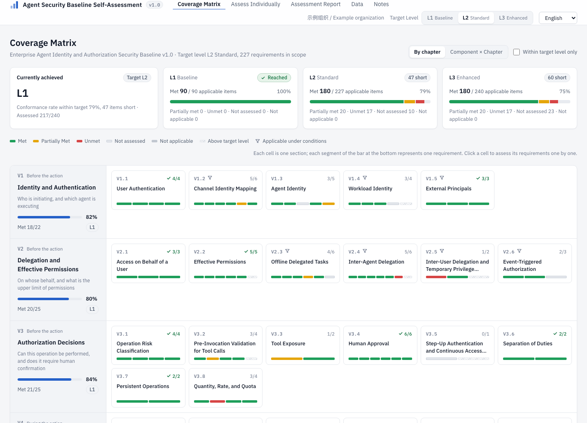

# 02 Mode d'emploi

Ce document explique comment utiliser l'outil d'auto-évaluation pour confronter une mise en œuvre au référentiel. Il décrit les trois modes d'utilisation (en ligne, hors ligne et déploiement privé), les règles de notation et le mode de conservation des données. Pour la structure de l'outil et sa maintenance, voir [03 Outil](../../03-tool/docs/fr.md).

## Exemple d'évaluation

Les captures ci-dessous (en anglais) ont été générées avec les données simulées incluses. Elles n'évaluent ni Teloa ni une plateforme réelle.


Les 90 exigences L1 sont satisfaites. Parmi les 137 exigences L2 supplémentaires, 90 sont satisfaites, 20 partiellement satisfaites, 17 non satisfaites et 10 non évaluées. Le total cible est de 180 sur 227, affiché à 79 % ; il reste 47 écarts avant L2. Les 13 exigences L3 sont non évaluées et exclues du taux de la cible L2.



### Reproduire les captures

1. Téléchargez le [JSON d'évaluation d'exemple](../examples/demo-assessment.json).
2. Importez le fichier dans la page Données de l'outil. L'import remplace l'évaluation actuelle ; exportez d'abord les données existantes au format JSON.
3. Consultez le rapport pour les niveaux et graphiques, puis la matrice de couverture pour localiser les écarts.

## 1. Trois modes d'utilisation

### 1.1 En ligne

La page peut être publiée sur GitHub Pages ou sur Cloudflare Pages, qui proposent tous deux une formule gratuite. Les étapes sont décrites à la section 4. Cloudflare Pages lit le fichier `_headers` situé sous `03-tool/` et applique les mêmes en-têtes de réponse de sécurité que la configuration nginx. GitHub Pages ne prend pas en charge les en-têtes de réponse personnalisés.

### 1.2 Hors ligne

Deux méthodes sont disponibles.

- **Page hors ligne** : téléchargez l'archive zip du dépôt, décompressez-la, puis ouvrez `03-tool/index.html` par double-clic. Les fonctionnalités sont identiques à celles de la version en ligne.
- **Excel hors ligne** : renseignez directement `03-tool/offline/baseline-assessment.xlsx`. Le classeur comporte des listes déroulantes, des formules de synthèse et un décompte des écarts. Une fois rempli, il peut être réimporté dans la page web pour poursuivre l'évaluation.

### 1.3 Déploiement privé

La page est constituée de fichiers statiques : tout serveur de fichiers statiques peut l'héberger. Le dépôt fournit une configuration d'image nginx qui s'exécute sous un utilisateur non root. Sa politique de sécurité du contenu (CSP) interdit à la page de se connecter à une adresse externe :

```bash
cd 03-tool && docker build -f deploy/Dockerfile -t agent-baseline-assessor .
docker run -d -p 8080:8080 --read-only --tmpfs /tmp agent-baseline-assessor
```

Sans Docker, copiez à la racine Web les éléments `index.html`, `assets/`, `data/`, `vendor/` et `offline/` situés sous `03-tool/`. Il est recommandé d'appliquer en même temps les en-têtes de réponse de sécurité définis dans `deploy/nginx.conf`. Les types MIME sont ceux du fichier `mime.types` fourni avec nginx. Il ne faut pas écrire de bloc `types {}` dans le bloc server, car il écraserait toute la table et la page serait téléchargée comme fichier au lieu d'être affichée.

## 2. Fonctionnalités

| Page | Fonctions |
| --- | --- |
| Matrice de couverture | En haut figurent le niveau atteint et l'état d'atteinte des niveaux L1, L2 et L3. En affichage par chapitre, chaque ligne correspond à un chapitre et chaque case à une section ; la barre de couleur segmentée en bas de la case indique l'état de chaque exigence. Passer à « Composant × chapitre » affiche un tableau thermique qui donne, pour chaque composant d'application et chaque chapitre, le taux de conformité. Cliquer sur une case permet d'évaluer les exigences une à une |
| Évaluation détaillée | Filtrage par chapitre, composant, niveau, état et mot-clé ; saisie de l'état ; renseignement des preuves, du responsable et de la date d'achèvement prévue. Une section non applicable peut être marquée dans son ensemble |
| Rapport d'évaluation | Présente d'abord la conclusion : échelle de maturité, nombre d'exigences restant à satisfaire pour atteindre le niveau suivant, taux de conformité dans le périmètre cible, écarts et avancement de l'évaluation. Liste ensuite les exigences à traiter en priorité. Les graphiques comprennent le radar des taux de conformité (par chapitre ou par composant), la maturité par section et la répartition des écarts. Tous peuvent être téléchargés au format PNG ou SVG. Un tableau statistique par composant et la liste complète des écarts complètent le rapport |
| Données | Saisie des informations d'évaluation ; export en JSON ou Excel ; import d'un JSON ou d'un Excel hors ligne ; chargement d'un résultat antérieur pour comparaison ; vidage de l'évaluation en cours |

Le fichier Excel exporté et le modèle hors ligne ont la même structure. Ils comportent cinq feuilles : évaluation, synthèse (les formules se recalculent en temps réel selon l'état, et le niveau cible se choisit dans une liste déroulante), liste des écarts, perspective architecturale et notes.

## 3. Règles de notation

- **Taux de conformité** = exigences satisfaites ÷ exigences applicables, en ne comptant que celles du niveau cible. Les exigences partiellement satisfaites et les exigences non évaluées sont comptées comme non satisfaites.
- **Atteinte d'un niveau** : un niveau n'est atteint que si toutes les exigences applicables de ce niveau et des niveaux inférieurs sont satisfaites. Il suffit d'une exigence manquante pour rester au niveau inférieur.
- **Entrée d'écart** : exigence applicable du niveau cible, qui n'est pas encore satisfaite.
- **Non applicable** : lorsque la plateforme ne dispose pas d'une capacité (par exemple, si elle ne prend pas en charge MCP), la section correspondante est marquée dans son ensemble comme non applicable et n'entre pas dans le calcul du taux de conformité.

La page web et le classeur Excel appliquent la même règle de calcul. Dans Excel, un état effacé, ou une valeur saisie en dehors de la liste déroulante, est compté comme non évalué.

## 4. Publication

### 4.1 Publication sur GitHub Pages

1. Créez un dépôt, puis poussez l'ensemble du projet sur la branche `main`. Le workflow se charge automatiquement de la construction à partir de `03-tool/`.
2. Dans les paramètres du dépôt, accédez à Settings → Pages → Build and deployment, puis sélectionnez **GitHub Actions** comme Source.
3. Ensuite, à chaque push sur `main`, `.github/workflows/pages.yml` régénère le classeur Excel hors ligne, exécute l'autocontrôle, puis ne publie que les fichiers nécessaires à la page. La tâche de construction n'a que des droits de lecture et n'exécute pas les scripts d'installation des dépendances. La tâche de publication n'exécute aucun code tiers.

Le compte gratuit GitHub ne permet d'activer Pages que pour les dépôts publics. Si le référentiel n'est pas encore public, il convient d'utiliser le déploiement privé ou GitHub Enterprise, qui prend en charge les Pages privées.

### 4.2 Publication sur Cloudflare Pages

Une seule des deux méthodes suivantes est à retenir.

- **Connexion à un dépôt GitHub** : console Cloudflare → Workers & Pages → Créer → Pages → Connecter à Git, puis sélection du présent dépôt. Dans Root directory (répertoire racine), saisir `03-tool`. Dans la commande de construction, saisir `mkdir -p _site && cp -r index.html _headers assets data vendor offline _site/`. Dans le répertoire de sortie, saisir `_site`. Chaque push est ensuite publié automatiquement.
- **Envoi direct en ligne de commande**, sans connexion à Git : exécuter la commande de construction ci-dessus dans le répertoire `03-tool/`, puis exécuter `npx wrangler pages deploy _site --project-name agent-baseline-assessor`.

L'adresse publiée est `https://<nom du projet>.pages.dev`. Il est également possible de lier un domaine propre. Pour réserver l'accès aux seuls collaborateurs internes, on peut ajouter une couche Cloudflare Access qui exige une connexion préalable par adresse e-mail professionnelle ou par IdP.

## 5. Données et confidentialité

- Les données d'évaluation sont conservées dans le stockage local du navigateur (localStorage). La page n'émet aucune requête réseau et ne contient aucun code de statistiques ni de télémétrie.
- Le stockage local est isolé par origine. Les pages de projet GitHub Pages partagent l'origine `<compte>.github.io` : les autres pages du même compte peuvent donc lire ces données. Dans Chrome, les pages ouvertes via file:// partagent également un même stockage. Lorsque le contenu de l'évaluation est sensible, il convient d'utiliser un domaine dédié ou un déploiement privé.
- Avant de changer d'ordinateur, de nettoyer le navigateur ou de confier la relecture à un tiers, exporter le JSON depuis la page « Données ».
- Lors de l'import d'un fichier, seuls les numéros présents dans le référentiel et les valeurs d'état connues sont acceptés. Tout le reste est ignoré. Tout texte affiché est échappé avant d'être rendu.

## 6. Langues

La page est disponible en 简体中文, English, 日本語, 한국어, Deutsch, Français et Español. La langue se change en haut à droite, sans incidence sur l'évaluation déjà saisie. À la première ouverture, la langue suit le réglage du navigateur ; ajouter `?lang=fr` (ou `zh-CN`, `en`, `ja`, `ko`, `de`, `es`) à l'adresse ouvre directement une langue donnée. Les fichiers Excel exportés utilisent la langue courante, et un fichier exporté dans n'importe quelle langue peut être importé. La grille hors ligne du dossier `offline/` est en chinois ; pour les autres langues, utiliser **Télécharger la grille d'évaluation vierge** sur la page **Données**.
