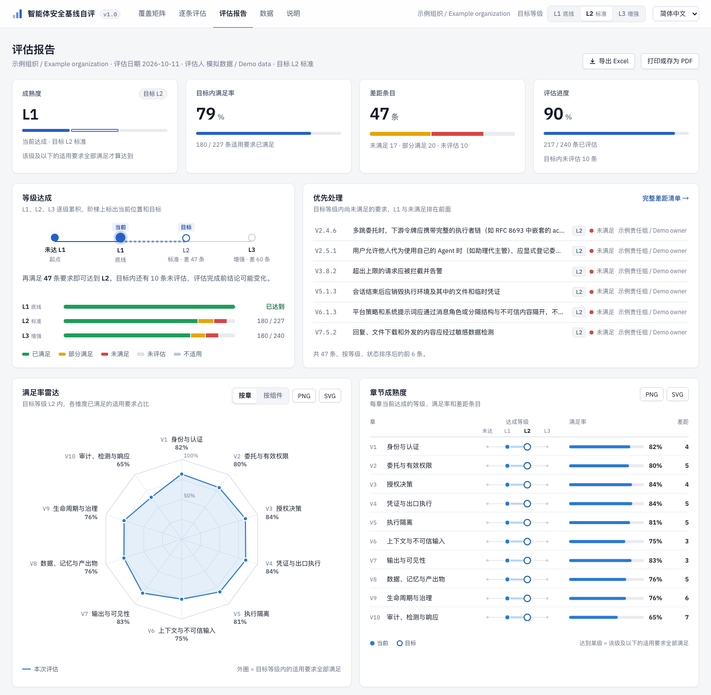
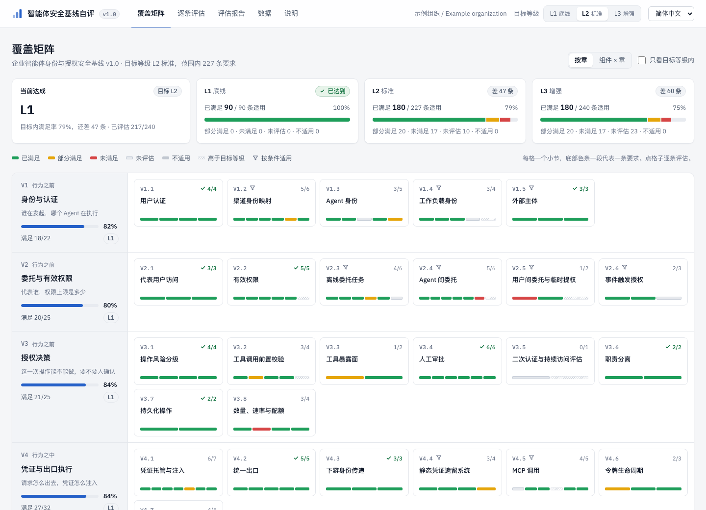

# 02 使用方法

本文说明如何用自评工具对照基线做评估，包括在线、离线和私有化三种用法，以及评分规则和数据保存方式。工具本身的目录结构和维护方法见 [03 工具](../../03-tool/docs/zh-CN.md)。

## 评估示例

下面的截图来自自评工具，使用仓库随附的模拟评估数据。它只演示评分和报告，不对应 Teloa 或任何真实平台。



示例中，L1 的 90 条要求全部满足；L2 新增的 137 条中，90 条满足、20 条部分满足、17 条未满足、10 条未评估。目标内合计满足 180 / 227 条，网页显示 79%；距 L2 还差 47 条。L3 的 13 条未评估，且不计入目标 L2 的满足率。



### 重现截图

1. 下载[示例评估 JSON](../examples/demo-assessment.json)。
2. 打开工具，在「数据」页选择该文件导入。导入会替换当前评估；已有数据请先导出 JSON 留档。
3. 切换到「评估报告」查看成熟度阶梯与图表，再到「覆盖矩阵」定位差距。

## 1、三种用法

### 1.1 在线

可以发布到 GitHub Pages 或 Cloudflare Pages，两者都有免费方案，步骤见第 4 节。Cloudflare Pages 会读取 `03-tool/` 下的 `_headers`，带上与 nginx 配置相同的安全响应头；GitHub Pages 不支持自定义响应头。

### 1.2 离线

有两种方式。

- **离线网页**：下载仓库 zip 并解压，双击 `03-tool/index.html` 就能使用，功能和在线版完全一样。
- **离线 Excel**：直接填写 `03-tool/offline/baseline-assessment.xlsx`。表里带下拉选项、汇总公式和差距统计，填完可以导回网页继续评估。

### 1.3 私有化部署

页面是纯静态文件，任何静态文件服务器都能托管。仓库自带一份以非 root 身份运行的 nginx 镜像配置，内容安全策略禁止页面连接任何外部地址：

```bash
cd 03-tool && docker build -f deploy/Dockerfile -t agent-baseline-assessor .
docker run -d -p 8080:8080 --read-only --tmpfs /tmp agent-baseline-assessor
```

如果不用 Docker，把 `03-tool/` 下的 `index.html`、`assets/`、`data/`、`vendor/`、`offline/` 复制到 Web 根目录即可。建议同时套用 `deploy/nginx.conf` 中的安全响应头；MIME 类型沿用 nginx 自带的 `mime.types`，不要在 server 块里另写 `types {}`，否则会覆盖整张表，页面会被当作文件下载。

## 2、功能

| 页面 | 能做什么 |
| --- | --- |
| 覆盖矩阵 | 顶部是当前达成等级和 L1、L2、L3 三级的达成情况。按章查看时每行一章、每格一个小节，格子底部的分段色条逐条显示状态；切到「组件 × 章」是一张热力表，看每个落点组件在每章的满足率。点开格子即可逐条评估 |
| 逐条评估 | 按章、组件、等级、状态和关键词筛选，标记状态，填写证据、负责人和计划完成时间。不适用的小节可以整节标记 |
| 评估报告 | 先给结论：成熟度阶梯、到下一级还差几条、目标内满足率、差距条目和评估进度，再列出优先处理的要求。图表包括满足率雷达（按章或按组件）、章节成熟度、差距分布，均可下载 PNG 或 SVG；另附按组件统计表和完整差距清单 |
| 数据 | 填写评估信息；导出 JSON 或 Excel；导入 JSON 或离线 Excel；载入上一次的结果做对比；清空当前评估 |

导出的 Excel 和离线模板结构相同，包含评估表、汇总（公式随状态实时计算，目标等级可下拉切换）、差距清单、架构视角和说明五页。

## 3、评分规则

- **满足率** = 已满足 ÷ 适用要求，只统计目标等级内的要求。部分满足和未评估都按未满足计。
- **达到某一级**：该级及以下的全部适用要求都已满足才算达到，少一条就停在下一级。
- **差距条目**：目标等级内、适用、但尚未满足的要求。
- **不适用**：平台不具备某项能力时（例如不支持 MCP），对应小节整节标为不适用，不计入满足率。

网页和 Excel 使用同一套规则。在 Excel 里把状态清空或填了下拉以外的值，都按未评估计。

## 4、发布

### 4.1 发布到 GitHub Pages

1. 新建仓库，把整个项目推送到 `main` 分支。工作流会自动进入 `03-tool/` 构建。
2. 在仓库 Settings → Pages → Build and deployment 中，将 Source 选为 **GitHub Actions**。
3. 之后每次推送到 `main`，`.github/workflows/pages.yml` 都会重新生成离线评估表、运行自检，再只发布页面所需的文件。构建作业只有读权限，安装依赖时不执行安装脚本；发布作业不运行任何第三方代码。

GitHub 免费账户只能为公开仓库开启 Pages。如果基线暂不公开，可以使用私有化部署，或者使用支持私有 Pages 的 GitHub 企业版。

### 4.2 发布到 Cloudflare Pages

任选一种方式。

- **连接 GitHub 仓库**：Cloudflare 控制台 → Workers & Pages → 创建 → Pages → 连接 Git，选中本仓库。Root directory（根目录）填 `03-tool`，构建命令填 `mkdir -p _site && cp -r index.html _headers assets data vendor offline _site/`，输出目录填 `_site`。之后每次推送都会自动发布。
- **命令行直接上传**，不需要连 Git：在 `03-tool/` 目录下运行上面的构建命令，再运行 `npx wrangler pages deploy _site --project-name agent-baseline-assessor`。

发布后的地址是 `https://<项目名>.pages.dev`，也可以绑定自己的域名。只想让公司内部访问时，可以再套一层 Cloudflare Access，要求先用企业邮箱或 IdP 登录。

## 5、数据与隐私

- 评估数据保存在浏览器的本地存储（localStorage）里，不会上传。在线版仅加载页面、图片、字体等静态资源，不包含统计或遥测代码。
- 本地存储按「源」隔离，而不是按目录隔离。`security.teloa.ai` 下的项目目录共用同一个源，GitHub Pages 的 `<账号>.github.io` 项目页也是如此；同源其他页面可读取这份数据。Chrome 中通过 file:// 打开的本地网页也可能共用存储。评估内容敏感时，请使用专用域名或私有化部署。
- 从旧 GitHub Pages 地址切换到新域名时，浏览器不会自动迁移评估数据。请先在旧地址导出 JSON，再在新地址导入。
- 换电脑、清理浏览器或交给他人复核之前，请先在「数据」页导出 JSON。
- 导入文件时，只接受基线中存在的编号和已知的状态值，其他内容一律忽略。所有显示的文本都会先转义再渲染。

## 6、语言

页面支持简体中文、English、日本語、한국어、Deutsch、Français、Español，在右上角切换，切换不影响已填写的评估。首次打开时默认使用简体中文，手动切换后会记住所选语言，也可以在地址后加 `?lang=en`（或 `zh-CN`、`ja`、`ko`、`de`、`fr`、`es`）直接打开指定语言。导出的 Excel 使用当前语言，导入时能识别任何一种语言导出的文件。`offline/` 下的离线评估表是中文版，其他语言可以在「数据」页点击「下载空白评估表」获取。
