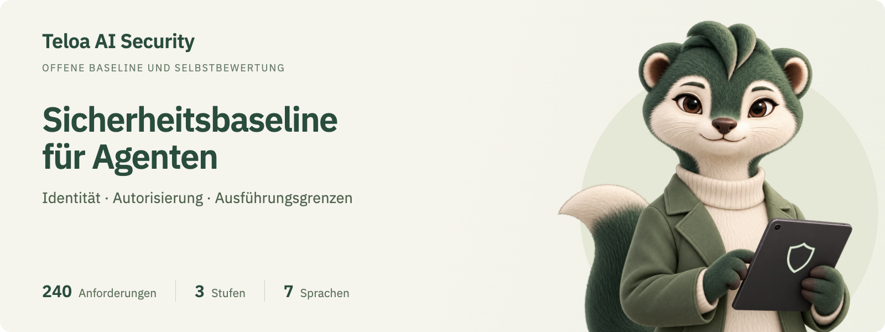
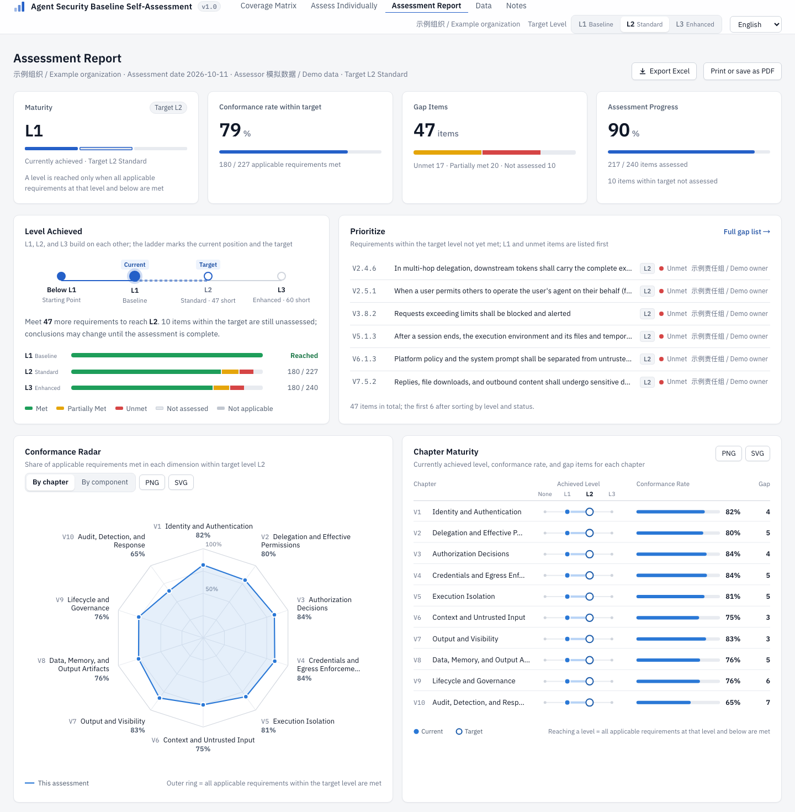

<p align="center">
  <a href="https://security.teloa.ai/agent-baseline-assessor/?lang=de"></a>
</p>

# Sicherheitsbaseline für Identität und Autorisierung von Unternehmensagenten

Eine offene Sicherheitsbaseline mit Selbstbewertung aus der Entwicklung von Teloa

[English](README.md) · [简体中文](README.zh-CN.md) · [日本語](README.ja.md) · [한국어](README.ko.md) · **Deutsch** · [Français](README.fr.md) · [Español](README.es.md)

[Website](https://www.teloa.ai/en/) · [Dokumentation](https://docs.teloa.ai/en/) · [Marktplatz](https://market.teloa.ai/en/) · [KI-Sicherheit](https://security.teloa.ai/?lang=en) · [Blog](https://www.teloa.ai/en/blog/) · [Sicherheitsmeldungen](https://security.teloa.ai/report/?lang=en)

    

Die Sicherheitsbaseline für Identität und Autorisierung von Unternehmensagenten legt fest, welche Sicherheitsanforderungen an Identität und Autorisierung KI-Agenten in Unternehmensumgebungen erfüllen müssen. Sie beantwortet die grundlegenden Fragen hinter jeder Aktion eines Agenten: Wer hat sie ausgelöst, in wessen Auftrag wird sie ausgeführt, was darf der Agent tun, woher stammen die Zugangsdaten, wer sieht das Ergebnis und wie wird bei einem Vorfall die Zurechenbarkeit hergestellt?

Dieses Repository enthält die Baseline und ein zugehöriges Selbstbewertungswerkzeug. Die Baseline kann unmittelbar als Designvorgabe beim Aufbau einer Plattform, als Fragebogen für die Lieferantenbewertung oder als Checkliste für Sicherheitsreviews verwendet werden. Das Werkzeug ist eine statische Webseite, die Ergebnisse je Anforderung erfasst und daraus einen Reifegradbericht und eine Excel-Arbeitsmappe erstellt. Die Bewertungsdaten verbleiben im Browser des Nutzers.

Initiiert und gepflegt von [Teloa AI Security](https://github.com/teloa-ai)

Teloa AI Security ist eine Initiative für KI-Sicherheitsforschung und Open Source, die aus der Entwicklung von Teloa hervorgegangen ist. Sie untersucht Agentenidentität, Autorisierung, Ausführungsgrenzen und Sicherheitsgovernance und überführt Entwurfserfahrungen in eine offene Sicherheitsbaseline, Referenzarchitekturen und Bewertungswerkzeuge.

**Teloa, das Eichhörnchen im Sicherheitsteam**

| Zuerst die Identität prüfen | Berechtigungen begrenzen | Nachweise aufbewahren |
| :---: | :---: | :---: |
|  |  |  |

## Hintergrund und Ziel

Autor: Max Luo ([GitHub @cybermaxluo](https://github.com/cybermaxluo))

Max Luo hat dieses Projekt während der Entwicklung und Sicherheitsplanung von [Teloa](https://github.com/teloa-ai/teloa) erarbeitet. Ausgangspunkte sind Tool-Berechtigungen von KI-Mitarbeitern, menschliche Freigaben, Zugangsdaten, Ausführungsisolation und Datensichtbarkeit bei der Zusammenarbeit. Zusammen mit öffentlichen Spezifikationen werden daraus überprüfbare Anforderungen für Unternehmensagenten. Die Baseline ist für verschiedene Plattformen offen und nicht an Teloas Implementierung gebunden.

Die Baseline beschreibt Sicherheitsziele für Entwurf und Bewertung. Die Erfüllung ist je Anforderung anhand einer konkreten Produktversion, des Bereitstellungsumfangs und von Nachweisen zu prüfen. Selbstbewertung ist keine unabhängige Zertifizierung. Verweise und Zuordnungen zu OWASP, NIST, CSA und anderen Quellen bedeuten keine Unterstützung durch diese Organisationen.

Die [Entwurfsbegründung (Englisch)](04-design/en/design-rationale.md) erläutert typische Probleme, Abwägungen, zugehörige Anforderungen und Prüfmethoden getrennt von der Baseline.

## Überblick

| Punkt | Angaben |
| --- | --- |
| Version | v1.0 (2026-10-07) |
| Anforderungen | 240 Anforderungen in 10 Kapiteln und 62 Abschnitten, jeweils einzeln überprüfbar |
| Stufen | L1 Basisstufe: 90; L2 Standard ergänzt 137; L3 Erweitert ergänzt 13 |
| Aufbau | Angelehnt an OWASP ASVS 5.0; Anforderungsnummern im Format V&lt;Kapitel&gt;.&lt;Abschnitt&gt;.&lt;Punkt&gt;, z. B. V4.2.1 |
| Zuordnungen | OWASP Top 10 for Agentic Applications 2026, OWASP AISVS 1.0, CSA AICM v1.1 |
| Sprachen | Vereinfachtes Chinesisch (maßgebliche Fassung), Englisch, Japanisch, Koreanisch, Deutsch, Französisch, Spanisch |
| Lizenz | Baseline und Dokumentation CC BY 4.0; Code Apache-2.0 |

## Bewertungsbeispiel

Der folgende Bericht wurde mit simulierten Daten erzeugt und bewertet weder Teloa noch eine reale Plattform. Das Beispiel erreicht L1 und zielt auf L2: 180 von 227 anwendbaren Anforderungen sind erfüllt, etwa 79 %. Es fehlen 47 Anforderungen, darunter 10 noch nicht bewertete.



Siehe die [Beispielanleitung (Englisch)](02-usage/en/usage.md#assessment-example), oder laden Sie die [Beispiel-JSON-Datei](02-usage/examples/demo-assessment.json) herunter und importieren Sie sie auf der Datenseite des Werkzeugs.

## Abdeckung

Die Kapitel V1 bis V7 folgen der Reihenfolge, in der eine einzelne Aktion eines Agenten abläuft. V8 bis V10 behandeln Daten, Agenten und Audit-Aufzeichnungen, die sitzungsübergreifend bestehen bleiben.

<!-- coverage:start -->
| Kapitel | Name | Beantwortete Frage | L1 | L2 zusätzlich | L3 zusätzlich | Summe |
| --- | --- | --- | ---: | ---: | ---: | ---: |
| V1 | Identität und Authentifizierung | Wer initiiert, welcher Agent führt aus | 11 | 11 | 1 | 23 |
| V2 | Delegation und wirksame Berechtigungen | Im Auftrag von wem, wie hoch ist die Obergrenze der Berechtigungen | 11 | 14 | 3 | 28 |
| V3 | Autorisierungsentscheidung | Darf dieser Vorgang ausgeführt werden, ist eine Bestätigung durch einen Menschen nötig | 9 | 16 | 2 | 27 |
| V4 | Zugangsdaten und Durchsetzung am Egress | Wie verlässt die Anfrage das System, wie werden Zugangsdaten injiziert | 14 | 18 | 1 | 33 |
| V5 | Isolierung der Ausführung | In welchen Grenzen laufen Code, Befehle, Browser und Erweiterungen | 16 | 11 | 0 | 27 |
| V6 | Kontext und nicht vertrauenswürdige Eingaben | Dürfen eingelesene Inhalte die Entscheidung beeinflussen | 4 | 8 | 1 | 13 |
| V7 | Ausgabe und Sichtbarkeit | Wer sieht das Ergebnis, kann es abfließen | 6 | 12 | 0 | 18 |
| V8 | Daten, Gedächtnis und Arbeitsergebnisse | Wie werden Daten abgerufen, gespeichert und aufbewahrt | 5 | 16 | 1 | 22 |
| V9 | Lebenszyklus und Governance | Wer verwaltet den Agenten, von der Registrierung bis zur Außerbetriebnahme | 9 | 16 | 1 | 26 |
| V10 | Audit, Erkennung und Reaktion | Wie wird protokolliert, erkannt und eingedämmt | 5 | 15 | 3 | 23 |
| | **Summe** | | **90** | **137** | **13** | **240** |
<!-- coverage:end -->

## Stufen

Die Stufen bauen aufeinander auf. Eine Stufe gilt erst dann als erreicht, wenn alle anwendbaren Anforderungen dieser und der darunterliegenden Stufen erfüllt sind.

- **L1 Basisstufe**: Fehlen diese Anforderungen, entstehen unmittelbar Überschreitungen von Berechtigungen, Offenlegung von Zugangsdaten oder fehlende Zurechenbarkeit. Jede im Unternehmen eingesetzte Agentenplattform sollte diese Stufe erfüllen.
- **L2 Standard**: Fähigkeiten, die gängige Sicherheitsreviews in Unternehmen verlangen; für Plattformen, die interne Daten verarbeiten oder mehrere Geschäftssysteme anbinden.
- **L3 Erweitert**: mehrschichtige Verteidigung und feingranulare Governance; für hochregulierte Branchen wie Finanzwesen, Gesundheitswesen und kritische Infrastruktur oder für Plattformen, die hoch sensible Daten verarbeiten.

Fehlt einer Plattform eine Fähigkeit (etwa weil sie MCP nicht unterstützt), wird der betreffende Abschnitt insgesamt als nicht anwendbar markiert und nicht in die Erfüllungsquote einbezogen. Die Bewertungsregeln stehen in Kapitel 6 der Baseline.

## Schnellstart

Dies ist ein eigenständiges, selbst hostbares Projekt. Die Instanz bei Teloa AI Security ist eine öffentliche Demo; das Werkzeug und die Architekturgalerie sind unabhängig von Navigation, Seitenlayout und Diensten des Portals.

- **Baseline lesen**: [01-standard/de/baseline-v1.0.md](01-standard/de/baseline-v1.0.md)
- **Online bewerten**: Die aus diesem Repository veröffentlichte [GitHub-Pages-Seite](https://security.teloa.ai/agent-baseline-assessor/?lang=de) öffnen; die Sprache lässt sich oben rechts umschalten.
- **Offline bewerten**: Das Repository herunterladen und `03-tool/index.html` öffnen. Der Funktionsumfang entspricht der Online-Version; eine Netzwerkverbindung ist nicht erforderlich.
- **Excel verwenden**: [`03-tool/offline/baseline-assessment.xlsx`](03-tool/offline/baseline-assessment.xlsx) (Englisch) ausfüllen oder auf der Seite **Daten** des Werkzeugs über „Leere Bewertungstabelle herunterladen“ ein leeres Formular auf Deutsch herunterladen. Die Arbeitsmappe enthält Summenformeln und eine Lückenliste und kann wieder in das Werkzeug importiert werden.
- **Private Bereitstellung**: Das Werkzeug besteht ausschließlich aus statischen Dateien und wird mit einer gehärteten nginx-Konfiguration und einem Dockerfile ausgeliefert. Einzelheiten enthält die [Anleitung zur Verwendung](02-usage/de/usage.md).

## Aufbau des Repositorys

```
01-standard/<sprache>/baseline-v1.0.md   Baseline
01-standard/diagrams/                 Architekturabbildungen in sieben Sprachen: PNG, SVG, Mermaid
02-usage/<sprache>/usage.md              Verwendung: Bewertungsschritte, Bewertungsregeln, Bereitstellung, Datenspeicherung
02-usage/examples/, assets/           Simulierte Bewertungsdaten und Berichtsabbildungen
03-tool/                                 Selbstbewertungswerkzeug: Seite, Daten, Excel-Vorlage, Skripte, Bereitstellungskonfiguration
03-tool/docs/<sprache>.md                Wartungshinweise zum Werkzeug
04-design/zh-CN/, en/                 Designbegründung auf Chinesisch und Englisch
01-standard/diagrams/index.html      Architektur der Agent-Sicherheitsbaseline
.github/                                 GitHub-Pages-Workflow, Vorlagen für Issues und Pull Requests
```

## Dokumentation

| Dokument | Inhalt |
| --- | --- |
| [Baseline](01-standard/de/baseline-v1.0.md) | Geltungsbereich, Begriffe, Referenzarchitektur, Bedrohungsmodell, Stufenregeln, die 240 Anforderungen und Anhänge mit Zuordnungen |
| [Verwendung](02-usage/de/usage.md) | Online-, Offline- und private Bereitstellung; Bewertungsregeln; Veröffentlichung auf GitHub Pages oder Cloudflare Pages |
| [Werkzeugbeschreibung](03-tool/docs/de.md) | Verzeichnisstruktur, Befehle, Aktualisierung des Werkzeugs nach einer Revision der Baseline, Pflege der Übersetzungen |
| [Entwurfsbegründung (Englisch)](04-design/en/design-rationale.md) | Sicherheitsfragen aus der Teloa-Entwicklung, Abwägungen, Anforderungszuordnung und Prüfmethoden |
| [Architektur der Agent-Sicherheitsbaseline](https://security.teloa.ai/agent-baseline-assessor/01-standard/diagrams/?lang=de) | Technologiestack · Plattform-Referenzarchitektur · PNG / SVG / Mermaid |
| [Glossar](03-tool/i18n/glossary.md) | Terminologie in den sieben Sprachen |
| [Änderungsprotokoll](CHANGELOG.md) | Änderungen je Version (Chinesisch/Englisch) |

Maßgeblich ist die chinesische Fassung der Baseline; die anderen Sprachfassungen sind Übersetzungen. Sie wurden noch nicht vollständig von muttersprachlichen Fachleuten geprüft; Korrekturhinweise sind willkommen.

## Mitwirken

Rückmeldungen zu den Anforderungen, den Übersetzungen und dem Werkzeug sind willkommen. Vorab ist der [Leitfaden für Beiträge](CONTRIBUTING.md) (Chinesisch/Englisch) zu lesen: Änderungsvorschläge zu einer Anforderung müssen die adressierte Bedrohung und die Art der Überprüfung angeben, Änderungen an Übersetzungen folgen dem Glossar, und Änderungen am Werkzeug müssen die Selbsttests bestehen.

Mit der Teilnahme wird die Einhaltung des [Verhaltenskodex](CODE_OF_CONDUCT.md) zugesagt.

## Sicherheit

Sicherheitslücken im Werkzeug sind vertraulich gemäß der [Sicherheitsrichtlinie](SECURITY.md) (Chinesisch/Englisch) zu melden, nicht über ein öffentliches Issue. Rückmeldungen zu den Anforderungen selbst können als normales Issue eingereicht werden.

## Zitieren

Bei Zitaten ist die Version anzugeben, zum Beispiel:

> Max Luo. Sicherheitsbaseline für Identität und Autorisierung von Unternehmensagenten (Enterprise Agent Identity and Authorization Security Baseline), v1.0, 2026.

Bei Verweisen auf eine einzelne Anforderung sind Nummer und Version anzugeben, z. B. „V4.2.1 (v1.0)“. Maschinenlesbare Zitationsmetadaten enthält [CITATION.cff](CITATION.cff).

## Lizenz

- Baseline, Anleitung zur Verwendung und weitere Dokumentation: [CC BY 4.0](LICENSE-DOCS). Kopieren, Bearbeiten und kommerzielle Nutzung sind mit Namensnennung und Kennzeichnung von Änderungen gestattet.
- Code des Selbstbewertungswerkzeugs: [Apache License 2.0](LICENSE).
- Komponenten Dritter: ExcelJS 4.4.0 (MIT) und IBM-Plex-Schriften (SIL OFL 1.1); die Lizenztexte liegen in `03-tool/vendor/`.
- Teloa-Marke und Eichhörnchen-Grafiken: siehe [Markenmaterial](03-tool/assets/brand/README.md); Markennutzungsrechte bleiben gesondert vorbehalten.
