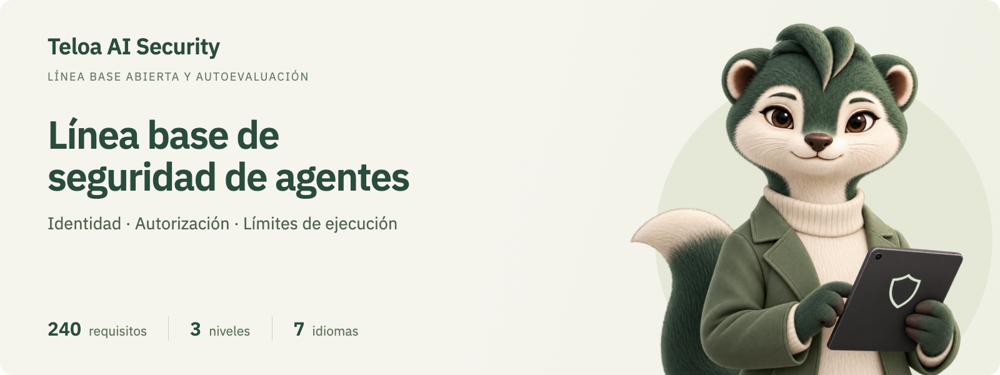

<p align="center">
  <a href="https://security.teloa.ai/agent-baseline-assessor/?lang=es"></a>
</p>

# Línea base de seguridad de identidad y autorización para agentes empresariales

Una línea base abierta de seguridad y autoevaluación derivada del desarrollo de Teloa

[English](README.md) · [简体中文](README.zh-CN.md) · [日本語](README.ja.md) · [한국어](README.ko.md) · [Deutsch](README.de.md) · [Français](README.fr.md) · **Español**

    

La Línea base de seguridad de identidad y autorización para agentes empresariales establece los requisitos de seguridad de identidad y autorización que deben cumplir los agentes de IA en un entorno empresarial. Responde a las preguntas básicas que hay detrás de cada acción de un agente: quién la inició, en nombre de quién se ejecuta, qué puede hacer, de dónde proceden sus credenciales, quién ve el resultado y cómo se atribuyen responsabilidades cuando algo sale mal.

Este repositorio contiene la línea base y una herramienta de autoevaluación complementaria. La línea base puede utilizarse directamente como insumo de diseño para construir una plataforma, como cuestionario para evaluar proveedores o como lista de verificación en revisiones de seguridad. La herramienta es una página web estática que registra los resultados requisito por requisito y genera un informe de madurez y un libro de Excel. Los datos de evaluación permanecen en el navegador del propio usuario.

Iniciada y mantenida por [Teloa AI Security](https://github.com/teloa-ai)

Teloa AI Security es una iniciativa de investigación en seguridad de la IA y de código abierto surgida del desarrollo de Teloa. Se centra en la identidad de los agentes, la autorización, los límites de ejecución y la gobernanza de la seguridad, y convierte la experiencia de diseño en una línea base abierta, arquitecturas de referencia y herramientas de evaluación.

**Teloa, la ardilla del equipo de seguridad**

| Verificar primero la identidad | Limitar los permisos | Conservar las evidencias |
| :---: | :---: | :---: |
|  |  |  |

## Origen y propósito

Autor: Max Luo ([GitHub @cybermaxluo](https://github.com/cybermaxluo))

Max Luo elaboró este proyecto durante el desarrollo y el diseño de seguridad de [Teloa](https://github.com/teloa-ai/teloa). Parte de cuestiones de acceso a herramientas, aprobación humana, credenciales, aislamiento de ejecución y visibilidad de datos en la colaboración. Al combinarlas con especificaciones públicas, las convierte en requisitos verificables para plataformas empresariales. Su uso y revisión están abiertos a distintas plataformas y no dependen de la implementación de Teloa.

Esta línea base describe objetivos de diseño y evaluación de seguridad. El cumplimiento debe verificarse requisito por requisito según una versión, un alcance de despliegue y evidencias concretas. La autoevaluación no es una certificación independiente. Las referencias y correspondencias con OWASP, NIST, CSA y otras fuentes no implican el respaldo de esas organizaciones.

La [justificación de diseño (en inglés)](04-design/en/design-rationale.md) explica problemas representativos, decisiones, requisitos relacionados y métodos de verificación por separado de la línea base.

## Resumen

| Elemento | Detalle |
| --- | --- |
| Versión | v1.0 (2026-10-07) |
| Requisitos | 240 requisitos en 10 capítulos y 62 secciones, cada uno verificable de forma independiente |
| Niveles | L1 Base: 90; L2 Estándar añade 137; L3 Reforzado añade 13 |
| Formato | Basado en OWASP ASVS 5.0; los identificadores de requisito siguen el formato V&lt;capítulo&gt;.&lt;sección&gt;.&lt;punto&gt;, por ejemplo V4.2.1 |
| Correspondencias | OWASP Top 10 for Agentic Applications 2026, OWASP AISVS 1.0, CSA AICM v1.1 |
| Idiomas | Chino simplificado (versión de referencia), inglés, japonés, coreano, alemán, francés, español |
| Licencia | Línea base y documentación CC BY 4.0; código Apache-2.0 |

## Ejemplo de evaluación

El siguiente informe se generó con datos simulados; no evalúa Teloa ni ninguna plataforma real. El ejemplo alcanza L1 y tiene L2 como objetivo: cumple 180 de 227 requisitos aplicables, aproximadamente el 79 %. Quedan 47 brechas, incluidas 10 sin evaluar.


Véase la [guía del ejemplo (en inglés)](02-usage/en/usage.md#assessment-example), o descargue el [JSON de ejemplo](02-usage/examples/demo-assessment.json) e impórtelo en la página Datos de la herramienta.

## Cobertura

Los capítulos V1 a V7 siguen el orden en que se desarrolla una acción de un agente. Los capítulos V8 a V10 abarcan los datos, los agentes y los registros de auditoría que persisten entre sesiones.

<!-- coverage:start -->
| Capítulo | Nombre | Pregunta que responde | L1 | Añade L2 | Añade L3 | Total |
| --- | --- | --- | ---: | ---: | ---: | ---: |
| V1 | Identidad y autenticación | Quién inicia la acción y qué Agente la ejecuta | 11 | 11 | 1 | 23 |
| V2 | Delegación y permisos efectivos | En representación de quién actúa y cuál es el límite máximo de permisos | 11 | 14 | 3 | 28 |
| V3 | Decisiones de autorización | Si esta operación puede realizarse y si requiere confirmación humana | 9 | 16 | 2 | 27 |
| V4 | Credenciales y ejecución en la salida | Cómo sale la solicitud y cómo se inyectan las credenciales | 14 | 18 | 1 | 33 |
| V5 | Aislamiento de la ejecución | Dentro de qué límites se ejecutan el código, los comandos, el navegador y las extensiones | 16 | 11 | 0 | 27 |
| V6 | Contexto y entradas no confiables | Si el contenido leído puede influir en las decisiones | 4 | 8 | 1 | 13 |
| V7 | Salida y visibilidad | Quién ve el resultado y si puede haber una filtración | 6 | 12 | 0 | 18 |
| V8 | Datos, memoria y productos generados | Cómo se recuperan, se acumulan y se conservan los datos | 5 | 16 | 1 | 22 |
| V9 | Ciclo de vida y gobernanza | Quién gestiona el Agente, desde su registro hasta su retirada | 9 | 16 | 1 | 26 |
| V10 | Auditoría, detección y respuesta | Cómo se registra, se detecta y se contiene | 5 | 15 | 3 | 23 |
| | **Total** | | **90** | **137** | **13** | **240** |
<!-- coverage:end -->

## Niveles

Los niveles son acumulativos. Un nivel solo se alcanza cuando se cumplen todos los requisitos aplicables de ese nivel y de los inferiores.

- **L1 Base**: su ausencia provoca directamente exceso de privilegios, fuga de credenciales o imposibilidad de atribuir responsabilidades. Toda plataforma de agentes utilizada en una empresa debería cumplirlo.
- **L2 Estándar**: capacidades que exigen las revisiones de seguridad empresariales habituales, para plataformas que procesan datos internos o se conectan a varios sistemas de negocio.
- **L3 Reforzado**: defensa en profundidad y gobernanza detallada, para sectores muy regulados, como finanzas, salud o infraestructuras críticas, o para plataformas que procesan datos de alta sensibilidad.

Cuando una plataforma carece de una capacidad (por ejemplo, no admite MCP), la sección correspondiente se marca como no aplicable en su totalidad y se excluye de la tasa de cumplimiento. Las reglas de valoración figuran en el capítulo 6 de la línea base.

## Inicio rápido

- **Leer la línea base**: [01-standard/es/baseline-v1.0.md](01-standard/es/baseline-v1.0.md)
- **Evaluar en línea**: abrir el sitio de [GitHub Pages](https://security.teloa.ai/agent-baseline-assessor/?lang=es) publicado desde este repositorio; el idioma se cambia en la esquina superior derecha.
- **Evaluar sin conexión**: descargar el repositorio y abrir `03-tool/index.html`. Funciona igual que la versión en línea y no requiere conexión de red.
- **Usar Excel**: completar [`03-tool/offline/baseline-assessment.xlsx`](03-tool/offline/baseline-assessment.xlsx) (en inglés) o descargar una hoja en blanco en español desde la página **Datos** de la herramienta, con el botón «Descargar la hoja de evaluación en blanco». El libro incluye fórmulas de resumen y una lista de brechas, y puede volver a importarse en la herramienta.
- **Despliegue privado**: la herramienta consta solo de archivos estáticos e incluye una configuración de nginx reforzada y un Dockerfile. Los detalles figuran en las [instrucciones de uso](02-usage/es/usage.md).

## Estructura del repositorio

```
01-standard/<idioma>/baseline-v1.0.md   Línea base
01-standard/diagrams/                 Diagramas en siete idiomas: PNG, SVG, Mermaid
02-usage/<idioma>/usage.md              Instrucciones de uso: pasos de evaluación, puntuación, despliegue, almacenamiento de datos
02-usage/examples/, assets/           Datos simulados y capturas de informes
03-tool/                                Herramienta de autoevaluación: página, datos, plantilla de Excel, scripts, configuración de despliegue
03-tool/docs/<idioma>.md                Guía de mantenimiento de la herramienta
04-design/zh-CN/, en/                 Fundamentos de diseño en chino e inglés
01-standard/diagrams/index.html      Arquitectura de la línea base de seguridad de agentes
.github/                                Flujo de trabajo de GitHub Pages, plantillas de issues y pull requests
```

## Documentación

| Documento | Contenido |
| --- | --- |
| [Línea base](01-standard/es/baseline-v1.0.md) | Alcance, términos, arquitectura de referencia, modelo de amenazas, reglas de niveles, los 240 requisitos y anexos de correspondencias |
| [Instrucciones de uso](02-usage/es/usage.md) | Uso en línea, sin conexión y en despliegue privado; reglas de puntuación; publicación en GitHub Pages o Cloudflare Pages |
| [Guía de la herramienta](03-tool/docs/es.md) | Estructura, comandos, actualización de la herramienta tras una revisión de la línea base, mantenimiento de las traducciones |
| [Justificación de diseño (en inglés)](04-design/en/design-rationale.md) | Cuestiones de seguridad de Teloa, decisiones, correspondencias y métodos de verificación |
| [Arquitectura de la línea base de seguridad de agentes](https://security.teloa.ai/agent-baseline-assessor/01-standard/diagrams/?lang=es) | Pila tecnológica · Arquitectura de referencia · PNG / SVG / Mermaid |
| [Glosario](03-tool/i18n/glossary.md) | Terminología en los siete idiomas |
| [Registro de cambios](CHANGELOG.md) | Cambios por versión (en chino e inglés) |

La versión china de la línea base es la de referencia; las demás versiones lingüísticas son traducciones. Aún no han sido revisadas por completo por expertos del ámbito que sean hablantes nativos, por lo que se agradecen las correcciones.

## Contribuciones

Se agradecen los comentarios sobre los requisitos, las traducciones y la herramienta. Antes de contribuir, conviene leer la [guía de contribución](CONTRIBUTING.md) (en chino e inglés): las propuestas de cambio de un requisito deben indicar la amenaza que abordan y cómo puede verificarse, los cambios de traducción siguen el glosario y los cambios en la herramienta deben superar las autopruebas.

La participación implica la aceptación del [código de conducta](CODE_OF_CONDUCT.md).

## Seguridad

Las vulnerabilidades de seguridad de la herramienta deben notificarse de forma privada según la [política de seguridad](SECURITY.md) (en chino e inglés), sin abrir issues públicos. Los comentarios sobre los propios requisitos pueden presentarse como un issue normal.

## Cita

Se ruega indicar la versión, por ejemplo:

> Max Luo. Línea base de seguridad de identidad y autorización para agentes empresariales (Enterprise Agent Identity and Authorization Security Baseline), v1.0, 2026.

Para citar un requisito concreto, se indican su identificador y la versión, por ejemplo «V4.2.1 (v1.0)». Los metadatos de cita legibles por máquina están en [CITATION.cff](CITATION.cff).

## Licencia

- La línea base, las instrucciones de uso y el resto de la documentación: [CC BY 4.0](LICENSE-DOCS). Se permite copiarlos, adaptarlos y usarlos con fines comerciales, siempre que se reconozca la autoría y se indique si se han realizado cambios.
- El código de la herramienta de autoevaluación: [Apache License 2.0](LICENSE).
- Componentes de terceros: ExcelJS 4.4.0 (MIT) y fuentes IBM Plex (SIL OFL 1.1); los textos de las licencias se incluyen en `03-tool/vendor/`.
- Marca Teloa e ilustraciones de la ardilla: consultar los [recursos de marca](03-tool/assets/brand/README.md); los derechos de uso de la marca se reservan por separado.
