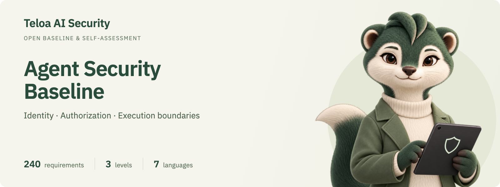

<p align="center">
  <a href="https://security.teloa.ai/agent-baseline-assessor/?lang=en"></a>
</p>

# Enterprise Agent Identity and Authorization Security Baseline

An enterprise agent identity and authorization security baseline and self-assessment tool derived from Teloa development, maintained by Teloa AI Security.

**English** · [简体中文](README.zh-CN.md) · [日本語](README.ja.md) · [한국어](README.ko.md) · [Deutsch](README.de.md) · [Français](README.fr.md) · [Español](README.es.md)

    

The Enterprise Agent Identity and Authorization Security Baseline sets out the identity and authorization security requirements that AI agents in an enterprise environment shall meet. It answers the basic questions behind every agent action: who initiated it, on whose behalf it runs, what it may do, where its credentials come from, who sees the result, and how accountability is established when something goes wrong.

This repository contains the standard and a companion self-assessment tool. The standard can be used directly as design input for building a platform, as a questionnaire for vendor assessment, or as a checklist for security review. The tool is a static web page that records results requirement by requirement and produces a maturity report and an Excel workbook. Assessment data stays in the user's own browser.

Initiated and maintained by [Teloa AI Security](https://github.com/teloa-ai)

Teloa AI Security is an AI security research and open-source initiative rooted in Teloa development. It focuses on agent identity, authorization, execution boundaries, and security governance, turning design experience into an open baseline, reference architectures, and assessment tools.

**Teloa the squirrel joins the security team**

| Verify identity first | Keep permissions narrow | Keep the evidence |
| :---: | :---: | :---: |
|  |  |  |

## Origins and purpose

Author: Max Luo ([GitHub @cybermaxluo](https://github.com/cybermaxluo))

Max Luo developed this project during the development and security design of [Teloa](https://github.com/teloa-ai/teloa). It draws on questions about AI employee tool access, human approval, credentials, execution isolation, and data visibility in collaboration. Combined with public specifications, these questions become verifiable requirements for enterprise agent platforms. The baseline is open to use and review across platforms and does not depend on Teloa's implementation.

This baseline describes security design and assessment goals. Compliance must be assessed requirement by requirement against a specific product version, deployment scope, and evidence. Self-assessment is not independent certification. References and mappings to OWASP, NIST, CSA, and other sources do not imply endorsement by those organizations.

The [design rationale](04-design/en/design-rationale.md) records representative problems, trade-offs, related requirements, and verification methods separately from the baseline's requirements.

## Overview

| Item | Details |
| --- | --- |
| Version | v1.0 (2026-10-07) |
| Requirements | 240 requirements in 10 chapters and 62 sections, each independently verifiable |
| Levels | L1 Baseline: 90; L2 Standard adds 137; L3 Enhanced adds 13 |
| Format | Modeled on OWASP ASVS 5.0; requirement IDs follow V&lt;chapter&gt;.&lt;section&gt;.&lt;item&gt;, e.g. V4.2.1 |
| Mappings | OWASP Top 10 for Agentic Applications 2026, OWASP AISVS 1.0, CSA AICM v1.1 |
| Languages | Simplified Chinese (authoritative), English, Japanese, Korean, German, French, Spanish |
| License | Standard and documentation CC BY 4.0; code Apache-2.0 |

## Assessment example

The report below was generated by the tool using simulated data. It is not an assessment of Teloa or any real platform. The example has achieved L1 and targets L2: 180 of 227 applicable requirements are met, about 79%, with 47 gaps remaining, including 10 unassessed requirements.


See the [coverage matrix and example walkthrough](02-usage/en/usage.md#assessment-example), or download the [example assessment JSON](02-usage/examples/demo-assessment.json) and import it on the tool's Data page.

## Coverage

Chapters V1 to V7 follow the order in which a single agent action unfolds. V8 to V10 cover data, agents and audit records that persist across sessions.

<!-- coverage:start -->
| Chapter | Name | Question it answers | L1 | L2 adds | L3 adds | Total |
| --- | --- | --- | ---: | ---: | ---: | ---: |
| V1 | Identity and Authentication | Who is initiating, and which agent is executing | 11 | 11 | 1 | 23 |
| V2 | Delegation and Effective Permissions | On whose behalf, and what is the upper limit of permissions | 11 | 14 | 3 | 28 |
| V3 | Authorization Decisions | Can this operation be performed, and does it require human confirmation | 9 | 16 | 2 | 27 |
| V4 | Credentials and Egress Enforcement | How requests leave, and how credentials are injected | 14 | 18 | 1 | 33 |
| V5 | Execution Isolation | Within what boundaries code, commands, browsers, and extensions run | 16 | 11 | 0 | 27 |
| V6 | Context and Untrusted Input | Can content that was read in influence decisions | 4 | 8 | 1 | 13 |
| V7 | Output and Visibility | To whom are results shown, and could they be leaked | 6 | 12 | 0 | 18 |
| V8 | Data, Memory, and Output Artifacts | How data is retrieved, accumulated, and retained | 5 | 16 | 1 | 22 |
| V9 | Lifecycle and Governance | Who manages agents, from registration to decommissioning | 9 | 16 | 1 | 26 |
| V10 | Audit, Detection, and Response | How activity is recorded, discovered, and contained | 5 | 15 | 3 | 23 |
| | **Total** | | **90** | **137** | **13** | **240** |
<!-- coverage:end -->

## Levels

Levels are cumulative. A level is achieved only when every applicable requirement at that level and below is met.

- **L1 Baseline**: absence directly causes unauthorized access, credential leakage or loss of accountability. Every agent platform used in an enterprise should meet it.
- **L2 Standard**: capabilities that mainstream enterprise security reviews require, for platforms that process internal data or connect to multiple business systems.
- **L3 Enhanced**: defense in depth and fine-grained governance, for highly regulated industries such as finance, healthcare and critical infrastructure, or platforms that process highly sensitive data.

When a platform lacks a capability (for example, it does not support MCP), the corresponding section is marked not applicable as a whole and excluded from the conformance rate. The judgment rules are in chapter 6 of the standard.

## Quick start

- **Read the standard**: [01-standard/en/baseline-v1.0.md](01-standard/en/baseline-v1.0.md)
- **Assess online**: open the [GitHub Pages](https://security.teloa.ai/agent-baseline-assessor/?lang=en) site published from this repository. First visits default to English; switch languages in the top-right corner.
- **Assess offline**: download the repository and open `03-tool/index.html`. It works the same as the online version and needs no network.
- **Use Excel**: fill in [`03-tool/offline/baseline-assessment.xlsx`](03-tool/offline/baseline-assessment.xlsx) (English), or download a blank form in your language from the tool's **Data** page. The workbook includes summary formulas and a gap list, and can be imported back into the tool.
- **Self-host**: the tool is plain static files and ships with a hardened nginx configuration and a Dockerfile. See the [usage guide](02-usage/en/usage.md).

## Repository layout

```
01-standard/<lang>/baseline-v1.0.md   The standard
01-standard/diagrams/                 Architecture figures in seven languages: PNG, SVG, Mermaid
02-usage/<lang>/usage.md              Usage guide: assessment steps, scoring, deployment, data storage
02-usage/examples/, assets/           Simulated assessment data and report screenshots
03-tool/                              Self-assessment tool: page, data, Excel template, scripts, deployment config
03-tool/docs/<lang>.md                Maintainer guide for the tool
04-design/zh-CN/, en/                 Design rationale in Chinese and English
01-standard/diagrams/index.html      Agent Security Baseline Architecture
.github/                              GitHub Pages workflow, issue and pull request templates
```

## Documentation

| Document | Contents |
| --- | --- |
| [Standard](01-standard/en/baseline-v1.0.md) | Scope, terms, reference architecture, threat model, level rules, the 240 requirements and mapping annexes |
| [Usage guide](02-usage/en/usage.md) | Online, offline and self-hosted use; scoring rules; publishing to GitHub Pages or Cloudflare Pages |
| [Tool guide](03-tool/docs/en.md) | Layout, commands, updating the tool after a revision of the standard, maintaining translations |
| [Design rationale](04-design/en/design-rationale.md) | Security questions from Teloa development, design trade-offs, requirement mappings, and verification methods |
| [Agent Security Baseline Architecture](https://security.teloa.ai/agent-baseline-assessor/01-standard/diagrams/?lang=en) | Technology stack · Platform reference architecture · PNG / SVG / Mermaid |
| [Glossary](03-tool/i18n/glossary.md) | Terminology across the seven languages |
| [Changelog](CHANGELOG.md) | Changes by version |

The Chinese version of the standard is authoritative; the other language versions are translations. They have not yet had a complete review by native-speaking domain experts, and corrections are welcome.

## Contributing

Feedback on the requirements, the translations and the tool is welcome. Please read the [contributing guide](CONTRIBUTING.md) first: proposed changes to a requirement should state the threat it addresses and how it can be verified, translation changes follow the glossary, and tool changes must pass the self-tests.

By participating you agree to follow the [code of conduct](CODE_OF_CONDUCT.md).

## Security

Report security vulnerabilities in the tool privately as described in the [security policy](SECURITY.md); please do not open a public issue. Feedback on the requirements themselves can be filed as a normal issue.

## Citation

Please cite the version, for example:

> Max Luo. Enterprise Agent Identity and Authorization Security Baseline, v1.0, 2026.

When citing a specific requirement, give its ID and version, e.g. "V4.2.1 (v1.0)". Machine-readable citation metadata is in [CITATION.cff](CITATION.cff).

## License

- The standard, usage guide and other documentation: [CC BY 4.0](LICENSE-DOCS). You may copy, adapt and use them commercially, with attribution and an indication of any changes.
- The self-assessment tool's code: [Apache License 2.0](LICENSE).
- Third-party components: ExcelJS 4.4.0 (MIT) and IBM Plex fonts (SIL OFL 1.1); license texts are included in `03-tool/vendor/`.
- Teloa brand and squirrel artwork: see [brand assets](03-tool/assets/brand/README.md); brand usage rights are reserved separately.
